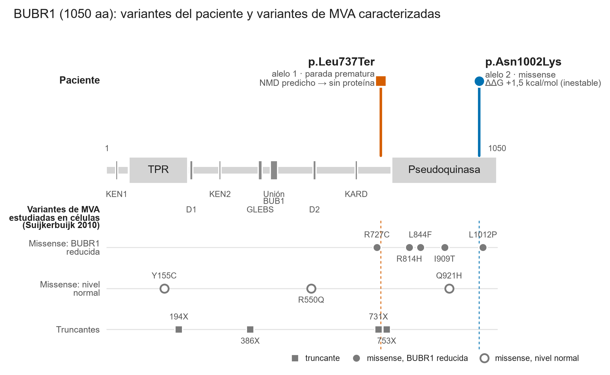
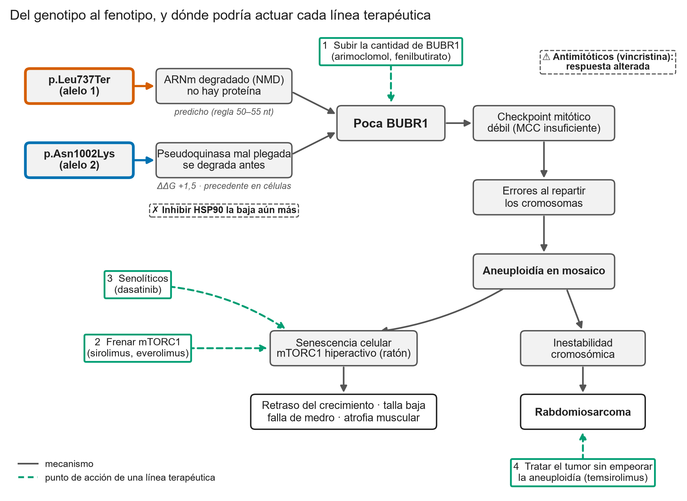

# Reposicionamiento de fármacos para la aneuploidía variegada en mosaico por *BUB1B*: de la variante al mecanismo

**MVA Hackathon 2026 · Track 2** · Equipo: [nombre] · Repositorio: https://github.com/ktalynagb/mva-hackathon-2026
**Estado: borrador v0 (8 oct).** Tareas E2 (plantilla) y E5 (integración, Hito H5, 21 oct). Exportar a PDF como `<usuario>_track2_report.pdf`.

> **Cómo se usa este archivo.** Cada sección dice de qué archivo sale y quién la cierra. Los bloques `[PENDIENTE]` se rellenan cuando la tarea de origen se fusiona. Las secciones de origen pueden ser más largas: aquí va la versión resumida. Antes de exportar, borrar estas notas y las líneas "Fuente/Tarea".

---

## Resumen

Un paciente pediátrico con aneuploidía variegada en mosaico (MVA) porta una heterocigosis compuesta en *BUB1B*: una variante de parada prematura en el exón 17 (p.Leu737Ter) con degradación predicha por NMD y un missense en la pseudoquinasa (p.Asn1002Lys) que desestabiliza la proteína por mal plegamiento. El resultado es **escasez de BUBR1** y un checkpoint mitótico débil, mecanismo que explica las aneuploidías en mosaico, el retraso grave del crecimiento intrauterino y la predisposición a rabdomiosarcoma del paciente.

A partir de ese mecanismo priorizamos cinco candidatos de reposicionamiento aprobados: **sirolimus** y **temsirolimus** (inhiben mTORC1, hiperactivo en ratones con poca BubR1), **arimoclomol** (proteostasis, aprobado en Niemann-Pick C), **dasatinib** (senolítico) y, como hipótesis especulativa, **niacina** (precursora de NAD⁺ para el eje SIRT2–BubR1 descrito en ratones). Todos pueden testarse en fibroblastos del paciente midiendo BUBR1 y la respuesta al nocodazol.

El análisis dominante sobre 92 genes de PanelApp identificó un hallazgo secundario con utilidad clínica: una variante truncante en *LZTR1* compatible con predisposición a schwannomatosis por *LZTR1* (penetrancia incompleta; seguimiento recomendado en niños). El análisis extendido a los genes del equipo (BRCA1/2, PALB2, RAD51C/D, CHEK2) no reveló variantes ultra-raras que pasaran el filtro dominante.

## 1. Introducción

*Fuente: `docs/secciones/02_marco_biologico.md` (secciones 1 y 3) · Tarea: B1*

- Qué es el MVA: enfermedad recesiva rara con aneuploidías en mosaico, retraso del crecimiento, microcefalia y predisposición a cáncer infantil (Hanks 2004).
- Genes: *BUB1B* (la mayoría de los casos), *CEP57*, *TRIP13* (Sieben 2020).
- El checkpoint mitótico y el papel de BUBR1 en el MCC, en un párrafo.
- El caso: fenotipo en términos HPO (rabdomiosarcoma HP:0002859, nefrocalcinosis HP:0000121, talla baja HP:0004322, falla de medro HP:0001508, atrofia muscular HP:0003202, prematuridad HP:0001622, pequeño para la edad gestacional HP:0001518; abortos recurrentes en los progenitores HP:0200067).
- Pregunta del trabajo: ¿qué mecanismo explica la enfermedad y qué fármacos aprobados podrían actuar sobre él?

## 2. Métodos

*Fuente: notebooks 01–05, `scripts/` · Tareas: A1, A3, B3, C3, E8*

### 2.1 Datos
VCF de genoma completo del paciente (GRCh38; Sentieon Haplotyper + GATK VariantFiltration) y documento clínico, del dataset `SageBio/mva-hackathon-2026-data`. No se usaron las lecturas crudas. Los datos no salen del equipo ni se suben al repositorio.

### 2.2 Identificación de la variante
1. Filtrado de variantes PASS en un panel de 321 genes de mitosis, cinetocoro, centrosoma, cohesina, lámina y poro nuclear, cromatina, reparación de ADN y ciclo celular (`config/genes_candidatos.txt`).
2. Frecuencia en gnomAD v4 (raras: AF < 1 %), consecuencia con Ensembl VEP en el transcrito **MANE Select**, CADD v1.7, ClinVar y predictores de dbNSFP.
3. Patrón recesivo: homocigota o dos heterocigotas en el mismo gen.
4. Clasificación ACMG/AMP con el sistema de puntos (Richards 2015; Tavtigian 2020; Abou Tayoun 2018; Pejaver 2022).
5. Análisis de sensibilidad con las variantes que no pasaron el filtro de calidad (notebook 02b).

### 2.3 Caracterización del mecanismo
- NMD por la regla de 50–55 nt (Nagy y Maquat 1998).
- Estructura: modelo de AlphaFold de BUBR1, entorno del residuo, accesibilidad y nucleótidos colocados por homología (AlphaFill).
- Estabilidad: ΔΔG con ThermoMPNN (Dieckhaus 2024) para todas las sustituciones del dominio.
- Revisión bibliográfica con verificación de cada cita en PubMed.

### 2.4 Priorización de fármacos y farmacogenética

*Fuente: `docs/secciones/03_criterios.md`, `03b_lista_larga.md`, `04_candidatos.md`, `05_farmacogenetica.md` · Tareas: C1, C3–C7*

1. **Lista larga.** Cuatro líneas terapéuticas derivadas del mecanismo (subir la cantidad de BUBR1, frenar mTORC1, eliminar células senescentes y tratar el tumor sin empeorar la aneuploidía), cada una con la dirección de acción buscada. Fuentes: DGIdb v5, Open Targets (incluidos los fármacos con ensayos en rabdomiosarcoma) y una lista curada con fuente para lo que las bases no capturan. 86 fármacos.
2. **Filtros de exclusión.** Aprobación comprobada en Drugs@FDA (openFDA) y en la EMA, no en la base de interacciones, y exclusión de los fármacos que debilitan la mitosis (inhibidores de HSP90, PLK1, Aurora, MPS1 y APC/C). Ninguno de los 162 inhibidores de esas dianas está aprobado.
3. **Puntuación.** Seis criterios de 0 a 3, con pesos: vínculo mecanístico 25, seguridad pediátrica 20, evidencia 15, compatibilidad con el caso 15, innovación 15 y validación factible 10. Puntaje de 0 a 100. Se puntuaron 52 candidatos y se agregó uno a mano (niacina).
4. **Verificación.** Cada afirmación sobre un fármaco se contrastó con el artículo original (PubMed) y con la ficha de la FDA. Esa revisión corrigió dos puntajes: sirolimus (un estudio asociaba, pero no había tratado, ratones con BubR1 alterada) y arimoclomol (la ficha indica que su mecanismo es desconocido y advierte de baja de peso y de efectos renales).
5. **Farmacogenética.** Se identificaron en el VCF del paciente variantes en CYP2B6, CYP2C19, CYP3A4, CYP3A5 y ABCB1 mediante `scripts/farmacogenetica.py`; los fenotipos se asignaron según las guías CPIC y PharmGKB. Los genotipos completos quedan en `data/farmacogenetica/` (no versionado). GSTM1 no es evaluable desde un VCF de SNV.

### 2.5 Reproducibilidad
[PENDIENTE · D2, D3] Comando único, versiones fijadas y tiempo de ejecución.

### 2.6 Uso de herramientas de IA
El reto exige declarar **proveedor, plan o nivel y configuración de datos** de cada herramienta. [PENDIENTE · E8: cada persona completa su fila]

| Herramienta | Proveedor | Plan o nivel | Configuración de datos (¿se usan para entrenar?) | Para qué se usó | ¿Recibió datos del paciente? | Quién |
|---|---|---|---|---|---|---|
| Claude Code (Sonnet y Opus) | Anthropic | Pro | Términos de consumidor; "Help improve Claude" desactivado (no se entrena con los chats) | Código de análisis, consultas a APIs, revisión de literatura, redacción de borradores | Sí, salidas a nivel de variante (posiciones, alelos, lecturas); los archivos de datos quedan en la computadora local | Ktalyna |
| Claude Code | Anthropic | [completar] | [completar] | [completar] | [completar] | Laura |
| Gemini (vía LangChain, cuaderno 06) | Google | [completar] | [completar] | Primer borrador de fármacos (descartado como lista final) | [completar] | [completar] |
| [otra] | | | | | | |

Todas las afirmaciones generadas con IA se verificaron contra la fuente primaria (PubMed, Drugs@FDA, gnomAD, UniProt). Las citas que no se pudieron verificar se retiraron (`02_marco_biologico.md`, sección 9).

## 3. Resultados

### 3.1 Variante causante

*Fuente: `docs/secciones/01_variante_causante.md` · Tareas: A1–A4 · Figura: A5 (lollipop)*

| | Alelo 1 | Alelo 2 |
|---|---|---|
| Cambio | c.2210T>G · p.Leu737Ter | c.3006T>G · p.Asn1002Lys |
| Consecuencia | Parada prematura, exón 17 de 23; NMD predicho | Missense en la pseudoquinasa |
| gnomAD v4 | AF 7,9×10⁻⁵, 0 homocigotos | 1 alelo (6,8×10⁻⁷), 0 homocigotos |
| Calidad de la llamada | PASS, fracción alélica 0,54, GQ 99 | PASS, fracción alélica 0,46, GQ 99 |
| ACMG | Probablemente patogénica (9 puntos); ClinVar: patogénica | VUS inclinada a patogénica (1–2 puntos) |

- **Diagnóstico diferencial:** *BUB1B* es el único de los 321 genes del panel con dos variantes raras funcionales en el transcrito MANE. Los otros cinco genes de MVA (*CEP57*, *TRIP13*, *CENATAC*, *SLF2*, *SMC5*) y *MAD2L1BP* no tienen ninguna. Anotar en MANE descartó 5 de 18 alertas que solo eran graves en transcritos secundarios; una de ellas daba un falso patrón recesivo en *SYNE2*.
- **Limitación principal:** sin muestras de los padres no se puede demostrar que las variantes estén en alelos distintos (*trans*).
- **Modelo dominante y hallazgo secundario (A10, C8):** en 92 genes de PanelApp (8 paneles) la única variante ultra-rara con efecto es **una truncante heterocigota en *LZTR1***, probablemente patogénica para **schwannomatosis por *LZTR1*** (dominante, penetrancia incompleta; PMID 24362817). Es un hallazgo secundario con vigilancia recomendada en niños (PMID 39937237). El análisis extendido (C8) sobre 10 genes del equipo —LMNA, KMT2D, KDM6A, ATM, BRCA1, BRCA2, PALB2, RAD51C, RAD51D, CHEK2— no encontró ninguna variante que pase el filtro dominante (874 PASS → 1 funcional en MANE → AF = 0,08 % → excluida por frecuente). Detalle: `01_variante_causante.md` §5c, `06_genes_equipo.md`.
- **Nefrocalcinosis:** ningún gen renal la explica (92 genes con el modelo dominante y 48 con el recesivo). Lo más probable es que se deba a la prematuridad: hasta 40 % de los prematuros la desarrollan (PMID 38296790).

**Figura 1. BUBR1 con las variantes del paciente y las variantes de MVA caracterizadas.** Arriba, las dos variantes del paciente: p.Leu737Ter (bermellón, truncante) y p.Asn1002Lys (azul, missense en la pseudoquinasa). Abajo, variantes de pacientes con MVA estudiadas en células por Suijkerbuijk et al. 2010, separadas según bajen la cantidad de BUBR1 o no. Las líneas punteadas alinean las variantes del paciente con las publicadas: p.Leu737Ter cae entre los truncamientos 731X y 753X, y p.Asn1002Lys junto a L1012P, en la región donde los missense reducen la proteína. Dominios: UniProt O60566 y Zhang et al. 2026. Generada con `scripts/figuras_informe.py`.

### 3.2 Mecanismo biológico

*Fuente: `docs/secciones/02_marco_biologico.md`, `02b_resumen_mecanismo.md` · Tareas: B1–B5 · Figura: B5*

- **Pérdida de función por falta de proteína.** El alelo 1 no produce proteína (NMD). El alelo 2 cae en la pseudoquinasa, donde todos los missense de MVA estudiados reducen BUBR1 de 5 a 10 veces por mal plegamiento, y llevarlos a niveles normales restaura el checkpoint (Suijkerbuijk 2010).
- **Estructura y estabilidad de N1002K:** residuo enterrado (pLDDT 91), con 3 enlaces de hidrógeno que la lisina no puede formar; ΔΔG +1,5 kcal/mol (percentil 72–75 del dominio), la mitad que la variante conocida de MVA p.Leu1012Pro (+3,1). No toca el bolsillo de ATP (a 29 Å).
- **Precedente más cercano:** un paciente con truncamiento en el codón 753 y p.Leu1012Pro (Hanks 2004; modelado por Sieben 2020). Mismo tipo de genotipo y misma región; ese paciente murió a los 3,6 meses.
- **Consecuencia:** checkpoint débil → reparto erróneo de cromosomas → aneuploidía en mosaico → senescencia y envejecimiento precoz (talla baja, atrofia muscular, posible mTORC1) e inestabilidad cromosómica (rabdomiosarcoma).

**Figura 2. Del genotipo al fenotipo.** Los dos alelos convergen en poca BUBR1, lo que debilita el checkpoint mitótico y produce aneuploidía en mosaico. De ahí salen dos ramas: senescencia (con mTORC1 hiperactivo en ratón), que explicaría el retraso del crecimiento y la atrofia muscular, e inestabilidad cromosómica, que lleva al rabdomiosarcoma. En verde, el punto de acción de cada línea terapéutica; en recuadros punteados, las dos advertencias. Las etiquetas en cursiva indican el nivel de evidencia de cada paso. La nefrocalcinosis no tiene un mecanismo establecido y no se incluye. Generada con `scripts/figuras_informe.py`.

### 3.3 Candidatos de reposicionamiento

*Fuente: `docs/secciones/04_candidatos.md` · Tareas: C2–C6 · Hito H4, 17 oct*

**Ninguno de los candidatos está probado en MVA.** Son hipótesis razonadas a partir del mecanismo, que se pueden comprobar con un mismo experimento: fibroblastos del paciente antes y después del fármaco, midiendo la cantidad de BUBR1 (Western blot) y el checkpoint mitótico (ensayo con nocodazol).

| Candidato | Línea | Puntaje | Evidencia | Riesgo principal |
|---|---|---|---|---|
| **Sirolimus** | 2 · frenar mTORC1 | 71,7 | En ratones con mutaciones de BubR1, la sarcopenia coincide con mTORC1 hiperactivo (Sieben 2020, PMID 31738183); la rapamicina frena la sarcopenia en ratón normal (Ham 2020, PMID 32908143). No se probó en un modelo BubR1 | Inmunosupresión durante la quimioterapia |
| **Temsirolimus** | 2 y 4 · mTORC1 y tumor | 70,0 | Mejor supervivencia en recaída de rabdomiosarcoma (fase II, PMID 31513481); sin beneficio en riesgo intermedio (fase III, PMID 38936378) | El beneficio depende del grupo de riesgo del tumor |
| **Arimoclomol** | 1 · proteostasis | 68,3 | Aprobado para Niemann-Pick C, pero la ficha de la FDA indica que su mecanismo es desconocido; sin estudios con BUBR1 | Baja de peso, sube la creatinina y hallazgos renales en ratas jóvenes; uso fuera de indicación |
| **Dasatinib** | 3 · senolítico | 60,0 | Elimina células senescentes junto con quercetina (PMID 25754370); evidencia indirecta | Mielosupresión que se suma a la de la quimioterapia |
| **Bortezomib** | 1 · proteasoma | 60,0 | El inhibidor de laboratorio MG132 sube la BUBR1 mutante en células (Suijkerbuijk 2010, PMID 20516114) | Neuropatía con vincristina; retrasa la salida de la mitosis |

[DECISIÓN DEL EQUIPO, 15 oct] Bortezomib es el candidato más cuestionable por su toxicidad y por frenar la salida de la mitosis; podría salir de la lista corta.

**Formulación del inhibidor de mTORC1: oral vs. nanopartícula.** Se evaluó el **nab-sirolimus** (Fyarro, nanopartículas de albúmina IV), propuesto por el equipo porque se acumula en el tumor y permitiría bajar la exposición sistémica. En xenoinjertos alcanza concentraciones tumorales 6,2–68,1 veces mayores que los rapálogos orales (Hou 2019, resumen AACR), y tiene dosis máxima tolerada definida en niños (15 mg/m², fase 1 del COG; PMID 39487711). Se mantiene sin embargo el **sirolimus oral** para la línea 2, por dos razones: (1) nuestra hipótesis mecanística es un efecto **sistémico** (sarcopenia y restricción del crecimiento por mTORC1 hiperactivo), de modo que la concentración tumoral no aporta; y (2) la toxicidad limitante del nab-sirolimus es la **trombocitopenia**, que se suma a la mielosupresión del VAC a intensidad reducida. Para la línea 4 (tumor), **temsirolimus** sigue primero por tener evidencia específica en rabdomiosarcoma, mientras que el fase 1 pediátrico de nab-sirolimus no mostró respuestas en los 2 rabdomiosarcomas incluidos. Detalle en `04_candidatos.md` §7.2.1.

#### Hipótesis innovadora: niacina (NAD⁺, SIRT2 y BubR1)

*Nivel de evidencia: especulativo. Se incluye por su originalidad y porque se puede descartar rápido, no porque esté respaldada.*

- **La idea.** BubR1 disminuye con la edad porque cae el NAD⁺ y SIRT2 deja de mantener su lisina 668 sin acetilar; con ese grupo, BubR1 se marca para destruirse. En ratones, el precursor de NAD⁺ llamado NMN sube BubR1, y sobreexpresar SIRT2 alarga la vida de los ratones con poca BubR1 (North 2014, PMID 24825348). La niacina (vitamina B3, aprobada por la FDA) también es precursora de NAD⁺. Como a este paciente le falta BubR1, subirla por esta vía atacaría la causa y no solo las consecuencias.
- **Por qué es distinta.** Las otras líneas actúan sobre las consecuencias (envejecimiento, senescencia, tumor) o sobre el plegamiento. Esta usa una vía descrita específicamente para regular la cantidad de BubR1. En PubMed (14 oct) ningún trabajo une NAD⁺, SIRT2, NMN o niacina con el MVA.
- **Lo que no sabemos.**
  1. Se probó NMN, no niacina, y en ratones con BubR1 normal o reducida, no con el mutante del paciente.
  2. La p.Asn1002Lys se degrada por mal plegamiento, que puede ser independiente de la lisina 668.
  3. El rescate de 2014 no tuvo réplica independiente. El mismo grupo mostró después que SIRT2 extra no alarga la vida de ratones normales (Wu 2023, PMID 38009412): el efecto parece específico de la poca BubR1, como en este paciente, pero eso no confirma el rescate.
  4. En células humanas, SIRT2 desacetila BubR1 en otra lisina (K250) y quitar SIRT2 no cambió la cantidad total de BubR1 (Suematsu 2014, PMID 25285631).
  5. La ficha de la FDA indica que la seguridad de la niacina en niños no está establecida, y subir NAD⁺ podría favorecer a un tumor activo.
- **Cómo se descartaría.** En fibroblastos del paciente tratados con niacina o NMN, medir BUBR1 total y acetilado en la lisina 668. Es el experimento más barato de la lista y se resuelve en una semana de laboratorio.

#### Línea condicional: tumor con RAS activado (inhibidores de MEK)

*Solo si la biopsia lo confirma.* Si el rabdomiosarcoma perdió la otra copia de *LZTR1* (pérdida de 22q11) o tiene la vía RAS activada (fosfo-ERK alto), un inhibidor de MEK aprobado en niños desde 1 año (**trametinib** o **selumetinib**, 65 puntos) combinado con **temsirolimus** tendría fundamento: la combinación MEK + PI3K/mTOR es letal para células de rabdomiosarcoma (PMID 23684925) y MEK + anti-IGF1R frena modelos con RAS mutado (PMID 36322002). Nunca en monoterapia: selumetinib solo no logró respuestas en niños (PMID 35363510). En PubMed hay un solo trabajo que une *LZTR1* con el rabdomiosarcoma.

Quedan excluidos los inhibidores de HSP90, PLK1, Aurora y MPS1, que bajarían aún más la BUBR1 o debilitarían la mitosis.

### 3.4 Farmacogenética

*Fuente: `docs/secciones/05_farmacogenetica.md` · Tarea: C7 · Script: `scripts/farmacogenetica.py`*

El paciente es **metabolizador intermedio de CYP2B6** (*1/*6 o similar) y de **CYP2C19** (*1/*2), lo que reduce levemente la activación de ciclofosfamida. Este resultado refuerza el argumento de usar dosis reducidas (protocolo Nishitani-Isa 2019, PMID 31184400). Para sirolimus, el fenotipo **CYP3A5 *3/*3** (no expresor) corresponde al perfil europeo estándar y no requiere ajuste de dosis inicial; se recomienda monitoreo de niveles (TDM) en las primeras dos semanas. Arimoclomol no tiene farmacogenética conocida; el riñón es el órgano centinela (la creatinina sérica sube 10–20 % por inhibición de OCT2, relevante en este paciente con nefrocalcinosis).

| Gen | Fenotipo | Fármaco relevante | Recomendación |
|-----|----------|-------------------|---------------|
| CYP2B6 | Metabolizador intermedio | Ciclofosfamida | Dosis reducida; TDM si eficacia o toxicidad inesperada |
| CYP2C19 | Metabolizador intermedio | Ciclofosfamida | Impacto menor; no accionable sin TDM |
| CYP3A5 | No expresor (*3/*3) | Sirolimus | Dosis estándar; TDM primeras 2 semanas |
| GSTM1 | No evaluable desde VCF de SNV | Ciclofosfamida | No se puede descartar GSTM1 nulo; requiere array o profundidad de lectura |

## 4. Discusión

**Solidez del diagnóstico molecular.** Las dos variantes de *BUB1B* reúnen los criterios para un diagnóstico de MVA1 con alta confianza. El alelo 1 (p.Leu737Ter) está clasificado patogénico en ClinVar y cumple PVS1 por la regla de los 55 nt (el codón de parada está a más de 55 nt del último exón-exón de MANE). El alelo 2 (p.Asn1002Lys) es VUS, pero su posición en la pseudoquinasa —donde todos los missenses de MVA estudiados en células reducen la cantidad de BUBR1 entre cinco y diez veces por mal plegamiento (Suijkerbuijk 2010)— y la similitud estructural con p.Leu1012Pro lo inclinan a patogénico. El dato externo del reto, que describe el caso como "heterocigosis compuesta clínicamente validada" (NHS), es coherente con nuestro genotipo. La limitación principal es la fase: sin muestras de los progenitores no se puede demostrar que ambas variantes estén en alelos distintos (*trans*), aunque el fenotipo grave hace que *cis* sea biológicamente improbable.

**Mecanismo y candidatos.** El argumento central —que el MVA en este paciente se debe a **escasez de BUBR1** más que a pérdida de actividad catalítica— tiene respaldo directo en la literatura (Suijkerbuijk 2010) y orienta la terapia hacia restablecer la cantidad de proteína o mitigar sus consecuencias. Los dos candidatos con mejor relación evidencia/riesgo son **sirolimus** y **temsirolimus**: en ratones con poca BubR1 la sarcopenia coincide con mTORC1 hiperactivo, la rapamicina la frena, y temsirolimus tiene datos de fase II en rabdomiosarcoma en recaída (PMID 31513481). **Arimoclomol** es el candidato más incierto: la ficha de la FDA declara que su mecanismo en Niemann-Pick C es desconocido, y hay advertencias de efectos renales en ratas jóvenes. **Dasatinib** tiene base senoTerapéutica sólida, pero su mielosupresión se suma a la de la quimioterapia. **Niacina** sigue siendo especulativa: el rescate de BubR1 se demostró con NMN en ratones y no tuvo réplica independiente. Para todos los candidatos, el experimento validatorio más directo es un Western blot de BUBR1 en fibroblastos del paciente, antes y después del tratamiento.

**Hallazgo secundario y su impacto.** La variante truncante en *LZTR1* tiene utilidad clínica independiente del MVA. ClinVar la clasifica patogénica o probablemente patogénica para schwannomatosis tipo 2 (dos laboratorios, 2024), y los portadores asintomáticos existen porque el gen tolera perder una copia (LOEUF 2,72). Las guías internacionales recomiendan seguimiento con RMN desde la infancia (PMID 39937237). Si la biopsia del tumor mostrara pérdida de 22q11 y activación de la vía RAS (fosfo-ERK elevado), un inhibidor de MEK aprobado en niños (**trametinib** o **selumetinib**) combinado con temsirolimus tendría fundamento mecanístico adicional.

**Innovación.** Este trabajo propone tres contribuciones originales: (1) tratar el MVA bialélico como una enfermedad de **déficit cuantitativo de proteína** —no de función catalítica—, lo que cambia el espacio de dianas terapéuticas; (2) la hipótesis del eje SIRT2–NAD⁺–BubR1 como diana específica para subir la proteína mutante (niacina), que en PubMed no tiene precedente en MVA; y (3) la búsqueda sistemática de un **segundo diagnóstico dominante** que va más allá del defecto primario y encuentra un hallazgo secundario clínicamente accionable (*LZTR1*).

**Escalabilidad.** El pipeline completo es reproducible y adaptable: cambiando el VCF y la lista de genes, sirve para cualquier caso de MVA o de otra enfermedad mendeliana rara con predisposición tumoral. Todas las consultas son a APIs públicas (gnomAD, Ensembl VEP, myvariant.info, OpenTargets), sin dependencia de bases de datos locales ni datos propietarios. El único paso que requiere juicio experto es la clasificación ACMG/AMP del alelo 2, que aquí está documentada con sus criterios y pesos.

**Próximos pasos prioritarios.** En orden de viabilidad e impacto: (1) genotipar a los progenitores para establecer la fase; (2) RT-PCR del alelo 1 para demostrar el NMD; (3) Western blot de BUBR1 en fibroblastos con y sin sirolimus, arimoclomol y niacina/NMN; (4) análisis de la biopsia del tumor: pérdida de 22q11 o segunda mutación de *LZTR1* y fosfo-ERK por inmunohistoquímica.

## 5. Referencias

Compiladas de `01_variante_causante.md` §9, `02_marco_biologico.md` §10 y `04_candidatos.md`. Existencia verificada en PubMed; texto completo no siempre leído (indicado).

**Variante y diagnóstico**
- Hanks et al. 2004. *Nat Genet* 36:1159–61. PMID 15475955. *(Artículo fundacional MVA — BUB1B; texto completo)*
- Matsuura et al. 2006. *Am J Med Genet A* 140A:1337–41. PMID 16411201.
- Sieben et al. 2020. *J Clin Invest* 130:736–50. PMID 31738183. *(BubR1 mTORC1 sarcopenia; texto completo)*
- Qu et al. 2025. *Zhonghua Yi Xue Yi Chuan Xue Za Zhi* 42. PMID 40555658. *(caso combinado regulatorio; solo resumen)*
- Wei et al. 2026. *Front Endocrinol* 17. PMID 42434306.

**Clasificación ACMG/AMP**
- Richards et al. 2015. *Genet Med* 17:405–24. PMID 25741868.
- Tavtigian et al. 2020. *Hum Mutat* 41:1734–7. PMID 32720330.
- Abou Tayoun et al. 2018. *Hum Mutat* 39:1517–24. PMID 30192042. *(PVS1)*
- Pejaver et al. 2022. *Am J Hum Genet* 109:2163–77. PMID 36413997. *(PP3/BP4)*

**Mecanismo**
- Suijkerbuijk et al. 2010. *Cancer Res* 70:4891–900. PMID 20516114. *(missenses BubR1 reducen cantidad de proteína; texto completo)*
- North et al. 2014. *Cell* 156:408–19. PMID 24825348. *(NAD⁺/SIRT2/BubR1; texto completo)*
- Wu et al. 2023. *Aging Cell* 22:e13812. PMID 38009412. *(SIRT2 no alarga vida en ratones normales)*
- Suematsu et al. 2014. *Oncotarget* 5:8148–59. PMID 25285631. *(SIRT2 BubR1 en células humanas)*

**Fármacos candidatos**
- Ham et al. 2020. *Aging* 12:20240–51. PMID 32908143. *(rapamicina frena sarcopenia en ratón normal)*
- Mascarenhas et al. 2019. *Cancer* 125:4058–66. PMID 31513481. *(temsirolimus fase II rabdomiosarcoma recaída)*
- Hawthorne et al. 2024. *J Clin Oncol* 42:1890–9. PMID 38936378. *(temsirolimus fase III rabdomiosarcoma)*
- Zhu et al. 2015. *Aging Cell* 14:72–7. PMID 25754370. *(dasatinib + quercetina senolíticos)*
- Crose et al. 2022. *Cancer Res* 82:6056–67. PMID 36322002. *(vía RAS rabdomiosarcoma sin fusión)*
- Elhossiny et al. 2023. *Mol Cancer Ther* 22:723–34. PMID 23684925. *(MEK + mTOR sinergia rabdomiosarcoma)*
- Federico et al. 2022. *J Clin Oncol* 40:3622–31. PMID 35363510. *(selumetinib monoterapia sin respuestas en niños)*
- Cramer et al. 2024. *Cancer Med* 13(21):e70376. PMID 39487711. *(ADVL1514: fase 1 COG de nab-sirolimus en tumores sólidos pediátricos; MTD 15 mg/m² en combinación, DLT trombocitopenia, 0/2 respuestas en rabdomiosarcoma alveolar)*
- Hou et al. 2019. *Cancer Res* 79(13 Suppl):348. *(resumen AACR del laboratorio desarrollador: acumulación tumoral de nab-sirolimus en xenoinjertos; sin datos intratumorales en humanos)*
- Nishitani-Isa et al. 2019. *Pediatr Int* 61:729–31. PMID 31184400. *(caso de MVA1 con rabdomiosarcoma tratado con VAC a intensidad reducida)*

**Hallazgo secundario LZTR1**
- Piotrowski et al. 2014. *Am J Hum Genet* 94:622–8. PMID 24362817. *(schwannomatosis LZTR1 dominante)*
- Perrino et al. 2025. *Am J Med Genet A* 197. PMID 39937237. *(seguimiento LZTR1 en niños)*

**Nefrocalcinosis**
- Oh y Butani 2024. *Pediatr Nephrol* 39:1259–70. PMID 38296790. *(nefrocalcinosis en prematuros)*

---

## Guía de estilo (E2)

**Texto**
- Español neutro, frases cortas y voz activa. El nombre del gen en cursiva (*BUB1B*) y la proteína en redonda (BUBR1).
- Variantes en HGVS con el transcrito la primera vez: `ENST00000287598: c.2210T>G (p.Leu737Ter)`.
- Separar siempre lo demostrado de lo predicho y de la hipótesis. Usar "predicho", "compatible con" o "hipótesis" cuando corresponda.
- Nada que pueda identificar al paciente o a su familia: sin fechas, lugares, nombres ni fotos.

**Figuras**
- Paleta apta para daltonismo (Okabe-Ito): azul `#0072B2`, naranja `#E69F00`, verde `#009E73`, bermellón `#D55E00`, gris `#999999`. **Alelo 1 = bermellón, alelo 2 = azul** en todas las figuras.
- Fuente sin serifa (Arial o DejaVu Sans), de 9 a 11 pt en el tamaño final.
- PNG a 300 ppp en `results/figura_<n>_<tema>.png`, generadas por código del repositorio.
- Pie de figura: qué muestra, de dónde salen los datos y qué script la genera.

**Tablas:** como máximo 6 columnas en el PDF; los detalles van en el repositorio.
