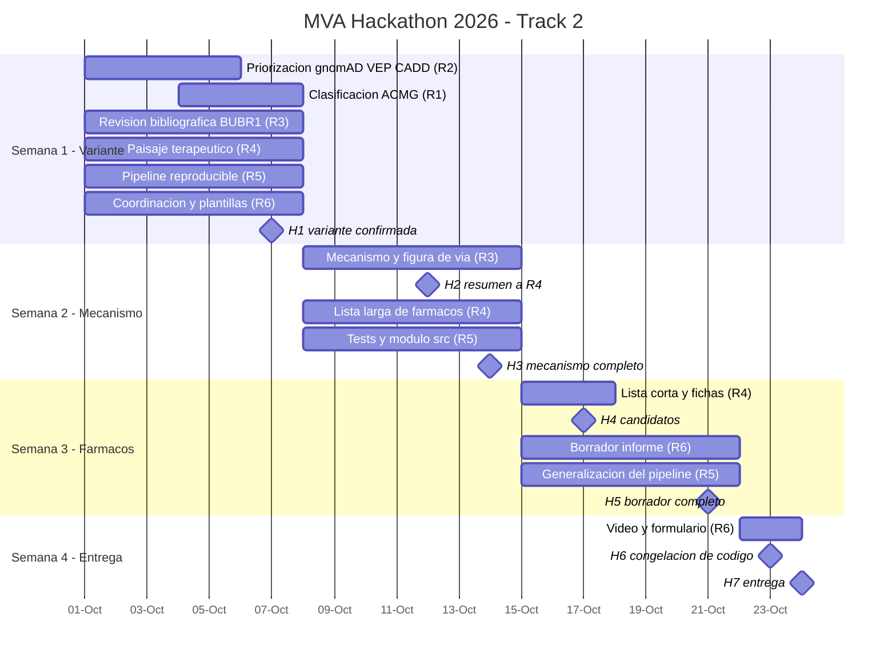

# Plan de Equipo y Roles — MVA Hackathon 2026 · Track 2

**6 personas · 4 semanas · Entrega: sábado 24 de octubre de 2026, 23:59 UTC**

Este documento define **qué hace cada rol, qué habilidades exige y qué entrega cada semana**. Léelo completo, elige el rol que mejor encaja contigo, anótate en la [tabla de asignación](#7-asignación-de-roles) y **sé fiel a ese rol** hasta la entrega.

Documentos relacionados: [plan de trabajo por fases](plan_de_trabajo.md) · [bitácora](bitacora.md) · [README](../README.md)

---

## Índice

1. [Resumen de los 6 roles](#1-resumen-de-los-6-roles)
2. [Calendario semanal e hitos](#2-calendario-semanal-e-hitos)
3. [Descripción detallada de cada rol](#3-descripción-detallada-de-cada-rol)
4. [Quién es dueño de qué (matriz de entregables)](#4-quién-es-dueño-de-qué)
5. [Flujo de trabajo entre roles](#5-flujo-de-trabajo-entre-roles)
6. [Cómo elegir tu rol](#6-cómo-elegir-tu-rol)
7. [Asignación de roles](#7-asignación-de-roles)
8. [Reglas de fidelidad al rol y del equipo](#8-reglas-de-fidelidad-al-rol-y-del-equipo)
9. [Semana 0: checklist de ingreso](#9-semana-0-checklist-de-ingreso-todas-las-personas)

---

## 1. Resumen de los 6 roles

Cada rol suma **100 %** repartido en cuatro áreas de habilidad:

- **Biotec/Genética:** genética humana, biología molecular, interpretación clínica
- **Farmacología:** mecanismos de fármacos, bases de datos de fármacos, seguridad
- **Programación/Datos:** Python, pandas, APIs, notebooks, git
- **Comunicación/Gestión:** redacción científica, figuras, coordinación, presentación

| # | Rol | Biotec/Genética | Farmacología | Programación/Datos | Comunicación/Gestión | Criterio que lidera | Semana de mayor carga |
|---|-----|:---:|:---:|:---:|:---:|---|---|
| R1 | Genetista e interpretación de variantes (líder científica) | **60 %** | 5 % | 20 % | 15 % | Rigor científico (35 %) | Semana 1 |
| R2 | Bioinformática de variantes | 25 % | 0 % | **70 %** | 5 % | Rigor científico (35 %) | Semana 1 |
| R3 | Biología molecular y mecanismo | **65 %** | 5 % | 20 % | 10 % | Rigor + Innovación | Semana 2 |
| R4 | Farmacología y reposicionamiento | 20 % | **50 %** | 20 % | 10 % | Impacto (25 %) + Innovación (25 %) | Semanas 2–3 |
| R5 | Ingeniería de software y reproducibilidad | 5 % | 0 % | **85 %** | 10 % | Escalabilidad (15 %) | Semanas 1–2 |
| R6 | Comunicación científica y coordinación | 25 % | 10 % | 5 % | **60 %** | Impacto (25 %) + entrega | Semanas 3–4 |

**Cobertura del equipo completo:** Biotec/Genética 33 % · Farmacología 12 % · Programación/Datos 37 % · Comunicación/Gestión 18 %.

---

## 2. Calendario semanal e hitos

Cada semana corresponde a una fase del [plan de trabajo](plan_de_trabajo.md). Las semanas van de **jueves a miércoles**; la semana 4 es corta (3 días).

| Semana | Fechas | Fase | Pregunta que respondemos | Estado |
|---|---|---|---|---|
| **1** | jue 1 – mié 7 oct | Fase 2: variante causante | ¿Qué variante causa el MVA en este paciente y con qué evidencia? | ✅ **Completada** (H1 logrado el 1 oct) |
| **2** | jue 8 – mié 14 oct | Fase 3: mecanismo | ¿Qué le hace esa variante a la proteína, a la célula y al paciente? | 🔄 En progreso |
| **3** | jue 15 – mié 21 oct | Fase 4: fármacos + borrador | ¿Qué fármacos aprobados actúan sobre ese mecanismo y cuáles son los mejores? | ⬜ Pendiente |
| **4** | jue 22 – sáb 24 oct | Fase 5: entrega | ¿Está todo reproducible, revisado, grabado y enviado? | ⬜ Pendiente |

### Hitos (no negociables)

| Hito | Fecha | Qué debe existir | Responsable | Estado |
|---|---|---|---|---|
| **H1** | mié 7 oct | Variante causante confirmada y clasificada con criterios ACMG | R1 (con R2) | ✅ **COMPLETADO** (1 oct) |
| **H2** | lun 12 oct | Resumen de mecanismo de 1 página entregado a R4 | R3 | 🔄 Notebook listo, revisar literatura |
| **H3** | mié 14 oct | Mecanismo completo + figura de la vía afectada | R3 | 🔄 Notebook listo, pulir figuras |
| **H4** | sáb 17 oct | Lista corta de 3 a 5 fármacos candidatos con ficha | R4 | ⬜ Pendiente |
| **H5** | mié 21 oct | Borrador completo del informe + guion del video v2 | R6 | ⬜ Pendiente |
| **H6** | vie 23 oct, 12:00 UTC | **Congelación del código** + video final grabado | R5 + R6 | ⬜ Pendiente |
| **H7** | sáb 24 oct, 18:00 UTC | **Entrega enviada** (6 h de margen antes del cierre) | R6 | ⬜ Pendiente |



---

## 3. Descripción detallada de cada rol

Cada rol tiene: perfil de habilidades, para quién es, herramientas, tareas por semana con su entregable, con quién se coordina y a quién revisa.

---

### R1 — Genetista e interpretación de variantes (líder científica)

> **En una frase:** decide, con evidencia, si una variante es la causa de la enfermedad, y responde por el rigor científico de todo el proyecto.

| Habilidad | % | |
|---|:---:|---|
| Biotec/Genética | 60 % | `████████████░░░░░░░░` |
| Farmacología | 5 % | `█░░░░░░░░░░░░░░░░░░░` |
| Programación/Datos | 20 % | `████░░░░░░░░░░░░░░░░` |
| Comunicación/Gestión | 15 % | `███░░░░░░░░░░░░░░░░░` |

**Herramientas:** guías ACMG/AMP, ClinVar, gnomAD browser, LOVD, OMIM, PubMed, Franklin/Varsome (como apoyo), lectura de tablas en pandas.

| Semana | Tareas | Entregable | Carga |
|---|---|---|---|
| **1** | ✅ **COMPLETADO.** Pipeline bioinformático ejecutado (notebooks 01–05). Variantes BUB1B confirmadas: p.Leu737Ter (Pathogenic ClinVar, CADD=36) + p.Asn1002Lys (AF=6.8×10⁻⁷, CADD=24.5). Pendiente: redactar `docs/secciones/01_variante_causante.md` con tabla ACMG formal y la limitación de fase (sin tríos). | `docs/secciones/01_variante_causante.md` — **redactar esta semana** | ~~Alta~~ → **Media** |
| **2** | Documentar el **diagnóstico diferencial**: por qué no son *CEP57*, *TRIP13* ni los otros 195 genes (datos ya en notebook 04). Apoyar a R3 sobre el efecto esperado de cada alelo (ya documentado en notebook 05). | Sección "Diagnóstico diferencial" en el mismo archivo | Media |
| **3** | Revisión científica de los candidatos de R4: ¿son coherentes con el genotipo (un alelo nulo + un alelo posiblemente hipomórfico)? Redactar la sección de resultados genéticos del informe. | Comentarios en el PR de R4 + sección del informe | Media |
| **4** | Revisión final de rigor del informe completo ("¿qué objetaría un revisor?"). Dar el visto bueno científico antes de H7. | Aprobación científica en el PR final | Media |

**Recibe de:** R2 (variantes priorizadas). **Entrega a:** R3 y R4 (variante confirmada), R6 (sección del informe).
**Revisa a:** R3 (contenido científico). **Lo revisa:** R3.

---

### R2 — Bioinformática de variantes

> **En una frase:** convierte 5 millones de variantes en una lista corta y justificada de candidatas, con código que cualquiera pueda volver a correr.

| Habilidad | % | |
|---|:---:|---|
| Biotec/Genética | 25 % | `█████░░░░░░░░░░░░░░░` |
| Farmacología | 0 % | `░░░░░░░░░░░░░░░░░░░░` |
| Programación/Datos | 70 % | `██████████████░░░░░░` |
| Comunicación/Gestión | 5 % | `█░░░░░░░░░░░░░░░░░░░` |

**Herramientas:** Python, pandas, Jupyter, APIs de gnomAD (GraphQL), myvariant.info, Ensembl VEP REST, CADD, SpliceAI, ClinVar; git.

| Semana | Tareas | Entregable | Carga |
|---|---|---|---|
| **1** | Pasar el notebook 04 de Laura (Colab) al repo y completarlo: frecuencia en gnomAD (AF < 1 %), consecuencia con VEP sobre el transcrito MANE Select, CADD, SpliceAI y ClinVar. Documentar el embudo con números reales (19 099 → ~669 → ~7). Aplicar el modelo recesivo (homocigotas + heterocigotas compuestas) sobre los 197 genes. Hacer un análisis de sensibilidad con las variantes no-PASS de los genes candidatos. | `notebooks/04_priorizacion_variantes.ipynb` y `results/variantes_priorizadas.tsv`. Entregar a R1 **a más tardar el lunes 5 oct**. | Alta |
| **2** | Revisar la evidencia de lecturas de las dos variantes de *BUB1B* (AD, DP, GQ y fracción alélica: ¿≈ 0,5 o sugiere mosaicismo?). Crear un *lollipop plot* de *BUB1B* con las variantes y los dominios (junto con R3). Entregar el código a R5 para convertirlo en script. | Figura `results/figuras/bub1b_lollipop.png` + celdas en el notebook 04 | Media |
| **3** | Dar soporte técnico a R4 con consultas masivas a APIs (DGIdb, Open Targets GraphQL). | Funciones reutilizables en `src/` (coordinado con R5) | Media |
| **4** | Congelar resultados. Junto con R5, verificar que una clonación limpia reproduce exactamente los mismos números. | Visto bueno de reproducibilidad | Baja |

**Recibe de:** VCF + lista de genes. **Entrega a:** R1 (variantes priorizadas), R5 (código), R4 (consultas).
**Revisa a:** R5 (código). **Lo revisa:** R1 (ciencia) y R5 (código).

---

### R3 — Biología molecular y mecanismo

> **En una frase:** explica qué le pasa a la proteína BUBR1, a la división celular y al paciente por culpa de estas variantes, y lo convierte en la figura central del proyecto.

| Habilidad | % | |
|---|:---:|---|
| Biotec/Genética | 65 % | `█████████████░░░░░░░` |
| Farmacología | 5 % | `█░░░░░░░░░░░░░░░░░░░` |
| Programación/Datos | 20 % | `████░░░░░░░░░░░░░░░░` |
| Comunicación/Gestión | 10 % | `██░░░░░░░░░░░░░░░░░░` |

**Herramientas:** PubMed, UniProt (BUBR1 = O60566, verificar), AlphaFold DB, ChimeraX o PyMOL, BioRender o Inkscape, Reactome y KEGG.

| Semana | Tareas | Entregable | Carga |
|---|---|---|---|
| **1** | Revisión bibliográfica: dominios de BUBR1 (cajas KEN, TPR, unión a BUB3/GLEBS, KARD, (pseudo)quinasa C-terminal); su papel en el SAC y en el complejo MCC; regulación de la unión cinetocoro-microtúbulo (vía PP2A-B56); modelos de ratón hipomórficos de BubR1 (fenotipo progeroide); genotipos típicos de MVA tipo 1. **Hipótesis a verificar:** en MVA1 el patrón frecuente es un alelo truncante + un alelo hipomórfico, porque la pérdida total en ambos alelos sería incompatible con la vida. | `docs/secciones/02_marco_biologico.md` (borrador con referencias) | Media |
| **2** | Con la variante confirmada (H1): ubicar Leu737 y Asn1002 en los dominios. Predecir si p.Leu737Ter dispara el NMD (regla de los 50–55 nt antes de la última unión exón-exón). Modelar p.Asn1002Lys en la estructura de AlphaFold (pLDDT, entorno, cambio de carga). Definir el **tipo de efecto**: pérdida de función (nulo + hipomorfo), ganancia de función o dominante negativo. Diseñar la **figura de la vía**: variante → menos BUBR1 funcional → SAC débil → segregación errónea → aneuploidía en mosaico → fenotipos (cáncer, RCIU, etc.). | Resumen de 1 página para R4 (**H2, lunes 12 oct**). `notebooks/05_mecanismo_biologico.ipynb` + `results/figuras/via_mecanismo.svg` (**H3**). | Alta |
| **3** | Evaluar la plausibilidad biológica de cada candidato de R4: ¿mejora o empeora la aneuploidía? Redactar la sección de mecanismo del informe. | Comentarios en el PR de R4 + sección del informe | Media |
| **4** | Pulir las figuras finales. Preparar la explicación del mecanismo para el pitch (30–40 s). | Figuras finales + guion del bloque de mecanismo | Baja |

**Recibe de:** R1 (variante). **Entrega a:** R4 (mecanismo, H2), R6 (figuras y texto).
**Revisa a:** R1 y R4 (ciencia). **Lo revisa:** R1.

---

### R4 — Farmacología y reposicionamiento

> **En una frase:** encuentra fármacos **ya aprobados** que podrían actuar sobre el mecanismo, los rankea con criterios explícitos y defiende los 3 a 5 mejores.

| Habilidad | % | |
|---|:---:|---|
| Biotec/Genética | 20 % | `████░░░░░░░░░░░░░░░░` |
| Farmacología | 50 % | `██████████░░░░░░░░░░` |
| Programación/Datos | 20 % | `████░░░░░░░░░░░░░░░░` |
| Comunicación/Gestión | 10 % | `██░░░░░░░░░░░░░░░░░░` |

**Herramientas:** DGIdb, Open Targets Platform, ChEMBL, DrugBank, Drug Repurposing Hub (Broad), ClinicalTrials.gov, fichas técnicas FDA/EMA, PubMed.

**Líneas de exploración sugeridas.** Son hipótesis para verificar, no conclusiones:
- **Readthrough del codón de stop** para el alelo p.Leu737Ter (aminoglucósidos, ataluren: verificar su estatus regulatorio actual).
- **Eje de la senescencia:** senolíticos como dasatinib + quercetina. Hay evidencia en ratones hipomórficos de BubR1 al eliminar células p16+.
- **mTOR y tolerancia a la aneuploidía** (rapamicina y análogos).
- **Implicación para el tratamiento oncológico:** un SAC débil podría cambiar la respuesta a los antimitóticos usados en rabdomiosarcoma (por ejemplo, vincristina). ¿Es un riesgo, una oportunidad o ambas cosas?

| Semana | Tareas | Entregable | Carga |
|---|---|---|---|
| **1** | Mapear el **paisaje terapéutico** sin esperar a la variante: fármacos aprobados que actúan sobre mitosis/SAC, aneuploidía, senescencia, readthrough, reparación del ADN y mTOR. Definir con R1 la **matriz de priorización** y sus pesos (aprobación FDA/EMA, solidez mecanística, seguridad pediátrica, interacción con el tratamiento de rabdomiosarcoma, vía de administración, evidencia existente). | `docs/secciones/03_criterios_y_paisaje.md` | Media |
| **2** | Con el mecanismo de R3 (H2): consultar DGIdb y Open Targets para *BUB1B* y su red (BUB3, CDC20, MAD2L1, PP2A, PLK1, AURKB, TTK, mTOR, p16/p21). Puntuar con la matriz y armar una **lista larga** de 20 a 30 fármacos. | `notebooks/06_candidatos_farmacos.ipynb` + `results/candidatos_farmacos.tsv` | Alta |
| **3** | **Lista corta** de 3 a 5 fármacos con ficha cada uno: mecanismo propuesto, nivel de evidencia, seguridad pediátrica, riesgos y **cómo se validaría** (fibroblastos del paciente, organoides, modelo celular de *BUB1B*). Redactar la sección de candidatos del informe. | `docs/secciones/04_candidatos.md` (**H4, sábado 17 oct**) | Alta |
| **4** | Preparar el bloque de fármacos del pitch (40 s) y responder las preguntas de revisión. | Guion del bloque de fármacos | Baja |

**Recibe de:** R3 (mecanismo), R2 (soporte de APIs). **Entrega a:** R6 (sección y slide), R1 y R3 (revisión).
**Revisa a:** R6 (texto del pitch). **Lo revisa:** R3 (biología) y R1 (rigor).

---

### R5 — Ingeniería de software y reproducibilidad

> **En una frase:** garantiza que cualquier persona (o el jurado) pueda clonar el repo y obtener los mismos resultados, y que el pipeline sirva para otros pacientes.

| Habilidad | % | |
|---|:---:|---|
| Biotec/Genética | 5 % | `█░░░░░░░░░░░░░░░░░░░` |
| Farmacología | 0 % | `░░░░░░░░░░░░░░░░░░░░` |
| Programación/Datos | 85 % | `█████████████████░░░` |
| Comunicación/Gestión | 10 % | `██░░░░░░░░░░░░░░░░░░` |

**Herramientas:** Python, git/GitHub (ramas, PRs), pytest, YAML, Makefile o `run_pipeline.py`, Docker (opcional), Windows y Linux/WSL/Colab.

| Semana | Tareas | Entregable | Carga |
|---|---|---|---|
| **1** | Crear un punto de entrada único (`run_pipeline.py` o `Makefile`) que corra todo de principio a fin. Centralizar parámetros en `config/config.yaml` (rutas, AF < 0,01, padding de 5 kb). Fijar versiones en `requirements.txt`. Con Laura, conciliar `config/genes_candidatos.txt` con su lista original de 201 genes. Configurar la protección de la rama `master` y una plantilla de PR. Probar el onboarding desde cero en otra máquina. | Pipeline ejecutable + `config/config.yaml` + plantilla de PR | Alta |
| **2** | Mover la lógica de los notebooks a un módulo (`src/mva/`). Escribir tests con pytest para las funciones críticas (`classify_zygosity`, `hgvs_id`, solapamiento de intervalos). Crear una **caché local** de las consultas a APIs (Ensembl ya dio *timeouts*) y añadir logging. | `src/mva/` + `tests/` pasando | Alta |
| **3** | **Escalabilidad:** generalizar el pipeline a "cualquier VCF + lista HPO + lista de genes" pasados como parámetros. Documentar cómo se correría con otro paciente MVA. Medir tiempo y memoria. Docker si da el tiempo. | Sección "Escalabilidad" en el README + benchmark | Media |
| **4** | **Congelación del código el viernes 23 oct a las 12:00 UTC.** Corrida limpia completa, tag `v1.0-entrega` y README final con "Cómo reproducir". | Release `v1.0-entrega` (**H6**) | Media |

**Recibe de:** R2 y R4 (código de los notebooks). **Entrega a:** todo el equipo (infraestructura), R6 (datos para el formulario de métodos).
**Revisa a:** R2 (código). **Lo revisa:** R2.

---

### R6 — Comunicación científica y coordinación

> **En una frase:** mantiene al equipo sincronizado, convierte el trabajo de todos en un informe claro y un video de 3 minutos, y se asegura de que la entrega llegue a tiempo.

| Habilidad | % | |
|---|:---:|---|
| Biotec/Genética | 25 % | `█████░░░░░░░░░░░░░░░` |
| Farmacología | 10 % | `██░░░░░░░░░░░░░░░░░░` |
| Programación/Datos | 5 % | `█░░░░░░░░░░░░░░░░░░░` |
| Comunicación/Gestión | 60 % | `████████████░░░░░░░░` |

**Herramientas:** Markdown, Canva, Figma o PowerPoint, un editor de video (CapCut, DaVinci), Pandoc o un exportador a PDF, Excel (formulario de métodos), el canal del equipo.

| Semana | Tareas | Entregable | Carga |
|---|---|---|---|
| **1** | Confirmar que **las 6 personas** tienen acceso aprobado en HF y aceptaron los términos. Crear el canal del equipo y fijar el sync semanal. Crear la plantilla `docs/informe_final.md` con secciones y dueños, la guía de estilo de figuras (paleta, fuentes) y el **registro de uso de IA**. Leer `methods_description_form.xlsx` y mapear qué pregunta debe responder cada rol. | Plantilla del informe + guía de estilo + mapa del formulario | Media |
| **2** | Escribir el guion del video v1 (3 min: problema 30 s · caso 30 s · variante 30 s · mecanismo 40 s · fármacos 40 s · escalabilidad 10 s). Integrar las secciones que vayan llegando. Escribir la entrada semanal de la bitácora. | `docs/guion_pitch.md` v1 + bitácora al día | Media |
| **3** | Integrar el **borrador completo del informe**. Producir las figuras finales con R3 y R4. Escribir el guion v2 y grabar un ensayo. | Borrador del informe (**H5, miércoles 21 oct**) | Alta |
| **4** | Grabar y editar el video final (22–23 oct). Completar el formulario de métodos. Exportar el informe a PDF. Revisar el checklist de entrega. **Enviar antes del sábado 24 oct a las 18:00 UTC.** | Entrega completa (**H7**) | Alta |

**Recibe de:** todos. **Entrega a:** el jurado.
**Revisa a:** todos los textos. **Lo revisa:** R4 (pitch) y R1 (rigor del informe).

---

## 4. Quién es dueño de qué

**Dueño** = responde por el entregable y toma la decisión final. **Revisor** = aprueba el PR. **Apoyo** = aporta cuando el dueño lo pide.

| Entregable | Dueño | Revisor | Apoyo | Estado |
|---|---|---|---|---|
| Notebooks 01–03: exploración y 201 genes | R1 (Ktalyna) | R2 | R5 | ✅ Hecho |
| Notebook 04: priorización gnomAD/CADD/ClinVar | R2 | R1 | R5 | ✅ Hecho (resultados en `results/hito_H1_resultados_finales.json`) |
| Clasificación ACMG + diagnóstico diferencial | R1 | R3 | R2 | 🔄 Datos listos, falta `docs/secciones/01_variante_causante.md` |
| Marco biológico + mecanismo + figura de la vía | R3 | R1 | R6 | 🔄 Notebook 05 listo, falta revisión literatura |
| Matriz de priorización de fármacos | R4 | R1 | — | ⬜ Pendiente (base en `results/resumen_mecanismo_para_R4.json`) |
| Lista larga y lista corta de candidatos | R4 | R3 | R2 | ⬜ Pendiente |
| Pipeline reproducible + tests + escalabilidad | R5 | R2 | — | ⬜ Pendiente |
| Informe final (Markdown → PDF) | R6 | R1 | todos | ⬜ Pendiente |
| Video pitch de 3 min | R6 | R4 | R3 | ⬜ Pendiente |
| Formulario de descripción de métodos | R6 | R5 | todos | ⬜ Pendiente |
| Bitácora y coordinación | R6 | — | todos | 🔄 Al día |

---

## 5. Flujo de trabajo entre roles

```
            ┌────────────┐   variantes priorizadas   ┌────────────┐
  VCF ────▶ │ R2 Bioinfo │ ────────── lun 5 oct ───▶ │ R1 Genética│
            └─────┬──────┘                           └─────┬──────┘
                  │ código                                  │ variante confirmada (H1, 7 oct)
                  ▼                                         ▼
            ┌────────────┐                           ┌────────────┐
            │ R5 Ingenie-│                           │ R3 Mecanis-│
            │ ría/Reprod.│                           │ mo         │
            └─────┬──────┘                           └─────┬──────┘
                  │ pipeline v1.0 (H6)                      │ resumen (H2, 12 oct)
                  │                                         ▼
                  │                                  ┌────────────┐
                  │                                  │ R4 Fármacos│
                  │                                  └─────┬──────┘
                  │                                        │ candidatos (H4, 17 oct)
                  ▼                                        ▼
            ┌──────────────────────────────────────────────────────┐
            │ R6 Comunicación: informe + video + formulario (H7)   │
            └──────────────────────────────────────────────────────┘
```

**Cómo evitar que un rol se quede esperando.** Ningún rol está inactivo en la semana 1: R3 y R4 avanzan con la literatura y el paisaje terapéutico sin necesitar la variante final, y R5 y R6 construyen infraestructura y plantillas.

---

## 6. Cómo elegir tu rol

**Paso 1.** Responde con honestidad cuál es tu fuerte:

| Si tu fuerte es... | Tu rol natural | Segunda opción |
|---|---|---|
| Genética clínica, leer casos, argumentar patogenicidad | **R1** | R3 |
| Python + datos, y te interesa la genómica | **R2** | R5 |
| Biología celular, mitosis, estructura de proteínas | **R3** | R1 |
| Farmacología, medicina, química farmacéutica | **R4** | R3 |
| Programación, git, automatización (sin importar la biología) | **R5** | R2 |
| Escribir, diseñar, presentar, organizar | **R6** | R4 |

**Paso 2.** Revisa la columna "Semana de mayor carga" de la [sección 1](#1-resumen-de-los-6-roles). Si sabes que no tendrás tiempo justo esa semana, elige tu segunda opción.

**Paso 3.** Anótate en la tabla de la sección 7 con un PR, o pídele a R6 que te anote. **Gana quien se anota primero**; si dos personas quieren el mismo rol, se resuelve en el primer sync.

> **Estado actual del proyecto (1 oct):** El Hito H1 ya fue completado — los notebooks 01–05 y el análisis de variantes están listos. El equipo que se incorpore arranca directamente en la Semana 2 (mecanismo + fármacos).
>
> **Rol de Ktalyna:** R1 (Genetista/líder científica). Lideró la bioinformática con Claude Code (notebooks 01–05, análisis real de gnomAD/CADD/ClinVar), tiene la visión científica completa del proyecto y actuará de traductora entre el trabajo computacional y el equipo biotecnólogo. La persona que tome R2 construye sobre los notebooks existentes, no los rehace.
>
> **Rol de Laura:** encaja con R2 (completar nb04 en el repo, lollipop plot) o R3 (mecanismo, que es su fuerte por el trabajo previo en Colab).

---

## 7. Asignación de roles

| Rol | Persona | Usuario GitHub | Usuario HF (acceso aprobado ✓) | Fecha |
|---|---|---|---|---|
| R1 — Genetista / líder científica | **Ktalyna Garcia** | `ktalynagb` | `Ktalyna` ✓ | 2026-10-01 |
| R2 — Bioinformática de variantes | | | | |
| R3 — Biología molecular y mecanismo | | | | |
| R4 — Farmacología y reposicionamiento | | | | |
| R5 — Ingeniería y reproducibilidad | | | | |
| R6 — Comunicación y coordinación | | | | |

---

## 8. Reglas de fidelidad al rol y del equipo

### Fidelidad al rol
1. **Un dueño por entregable.** El dueño decide; los demás aportan.
2. **Ayudar sí, invadir no.** Si quieres contribuir al entregable de otro rol, proponlo en el canal o en un comentario del PR; el dueño decide si lo incorpora.
3. **Si te bloqueas más de 24 h, avisa** en el canal y a R6. Es mejor un aviso temprano que un hito perdido.
4. **Cambiar de rol** solo se puede en el sync semanal, con acuerdo del equipo y registrándolo en la bitácora.
5. **Tus tareas son las de tu tabla.** Si aparece algo nuevo, se asigna en el sync, no se toma por iniciativa propia.

### Flujo de git
6. **Nada se sube directo a `master`.** Trabaja en ramas `rN/descripcion-corta` (ej. `r2/gnomad-vep`) y abre un PR.
7. **Todo PR lo aprueba el revisor designado** (sección 4) antes de hacer merge.
8. **Definición de "terminado":** está en `master` vía PR aprobado, documentado (las celdas markdown explican el *por qué*), se reproduce desde una clonación limpia y quedó registrado en la bitácora.

### Comunicación
9. **Check-in diario asíncrono** en el canal, en 3 líneas: *hice / haré / bloqueos*.
10. **Sync semanal los jueves** (30 min): revisar el hito de la semana anterior y planear la siguiente.
11. **Lo que no está en la bitácora, no pasó.** R6 consolida una entrada semanal; cada rol agrega una línea cuando cierra un entregable.

### Datos y ética (obligatorio por los términos del dataset)
12. **Cada integrante** debe registrarse como participante y tener su **propio** acceso aprobado en Hugging Face. **Nunca compartas los archivos de datos ni tu token.**
13. **Nunca subas** al repo `data/`, archivos VCF/BAM/FASTQ, tokens ni información que pueda reidentificar al paciente o su familia. Esto incluye el informe y el video.
14. **Registra el uso de IA generativa** (herramienta y para qué la usaste) en la bitácora; R6 lo traslada al formulario de métodos.
15. **Al terminar el hackathon**, cada integrante borra los datos de su equipo y notifica a `MVAHackathon2026@synapse.org`, según los términos de acceso.

---

## 9. Semana 0: checklist de ingreso (todas las personas)

Antes de empezar tu rol, completa esta lista:

- [ ] Registrada como participante del hackathon y con **acceso aprobado** a `SageBio/mva-hackathon-2026-data`
- [ ] Aceptada la invitación al repo de GitHub
- [ ] Repo clonado y los 5 pasos de "Cómo reproducir" del [README](../README.md) completados
- [ ] Notebooks 01, 02 y 03 corridos (o al menos leídos)
- [ ] Leídos el [plan de trabajo](plan_de_trabajo.md), la [bitácora](bitacora.md) y este documento completo
- [ ] Rol elegido y anotado en la [sección 7](#7-asignación-de-roles)
- [ ] Unida al canal del equipo y al sync semanal
