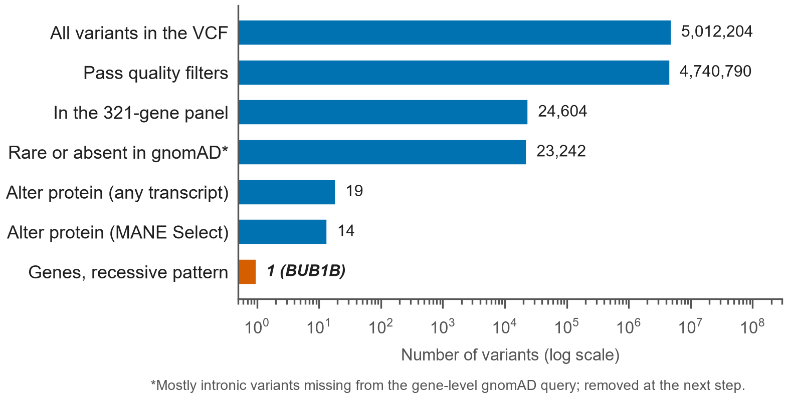
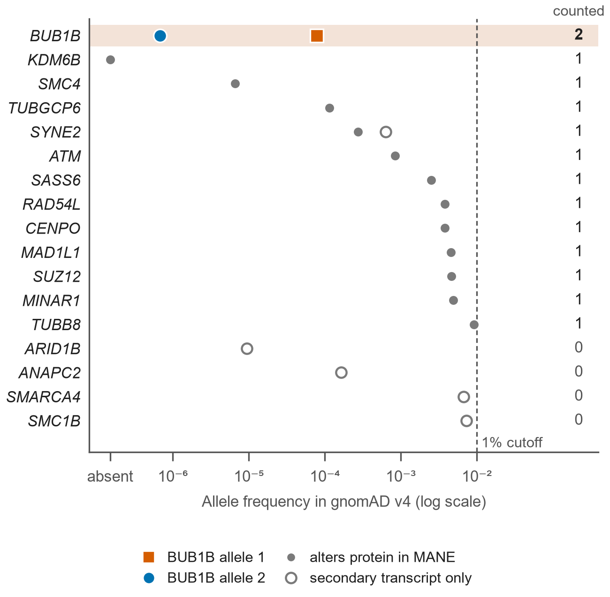
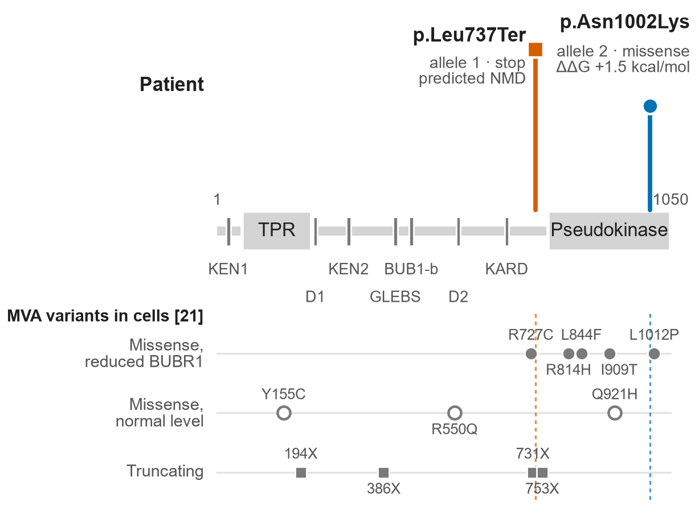
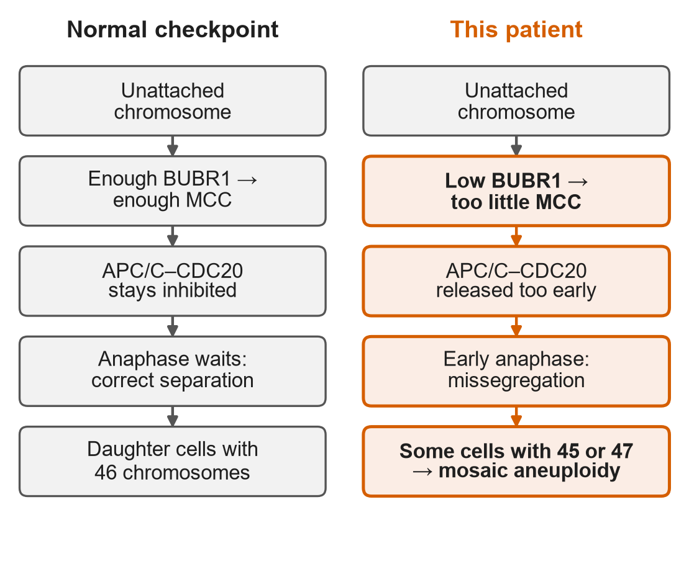
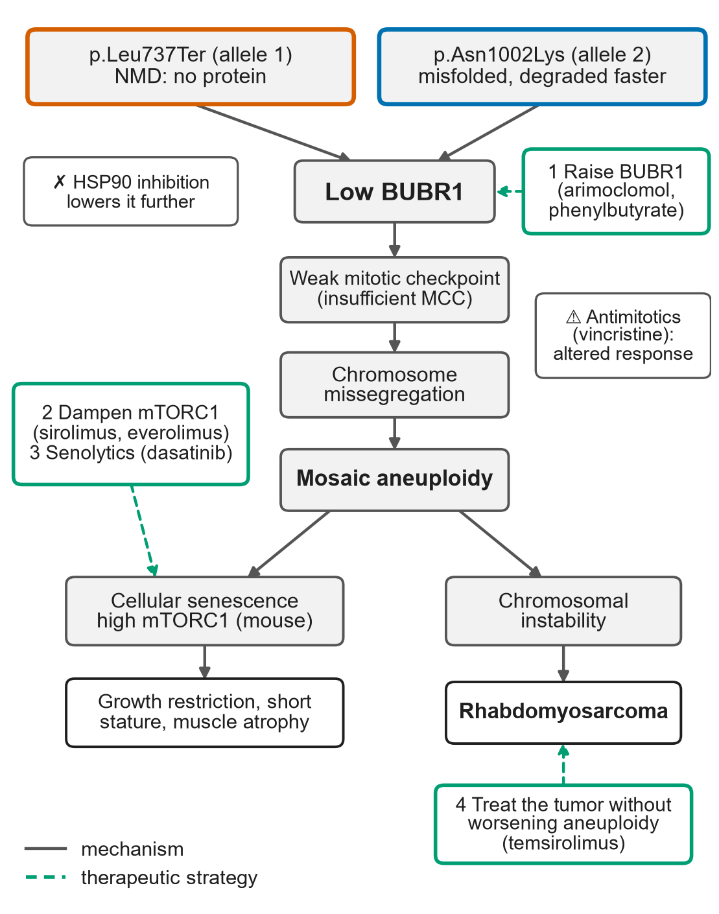
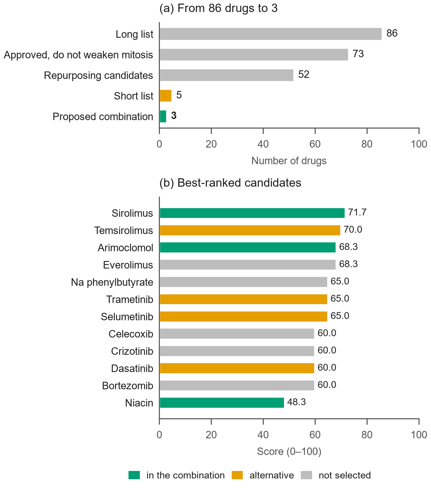
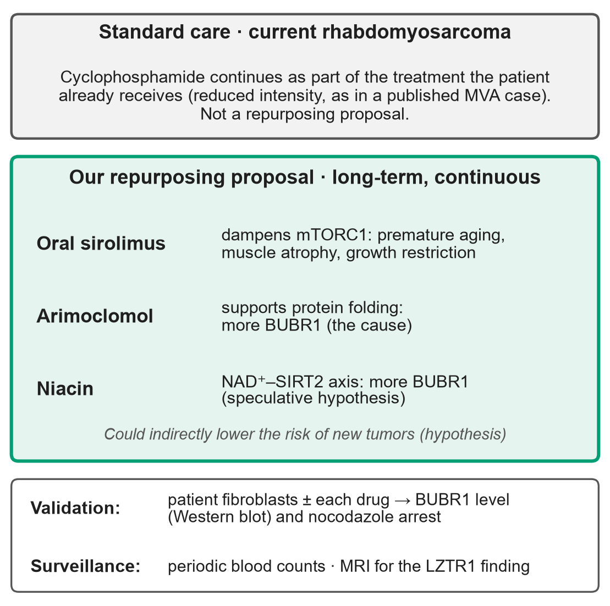

# Drug Repurposing for *BUB1B*-Associated Mosaic Variegated Aneuploidy: From Variant to Mechanism to Approved Drugs

**Team A3 EMBS ITBA** · MVA Hackathon 2026, Track 2 (Drug Repurposing) · Code: https://github.com/ktalynagb/mva-hackathon-2026

---

***Abstract*—Mosaic variegated aneuploidy (MVA) is a rare recessive disorder of chromosome segregation with no targeted treatment. We analyzed the whole-genome sequence of a pediatric patient with MVA, rhabdomyosarcoma, nephrocalcinosis, and growth restriction to identify the mechanism and approved drugs acting on it. Screening 24,604 high-quality variants in a 321-gene cell-division panel under a recessive model identified a single candidate gene, *BUB1B*, carrying two variants: p.Leu737Ter, a premature stop codon predicted to trigger nonsense-mediated decay, and p.Asn1002Lys, a pseudokinase missense variant of uncertain significance predicted to destabilize the protein. The mechanism is a partial loss of function caused by a shortage of BUBR1 protein, which weakens the spindle assembly checkpoint and leads to mosaic aneuploidy, premature-aging features, and cancer predisposition. From this mechanism we derived four therapeutic strategies, screened 86 drugs for FDA or EMA approval, excluded those that weaken mitosis, and ranked 52 candidates on six weighted criteria. Cyclophosphamide continues as part of the treatment the patient already receives for the current rhabdomyosarcoma. For the remaining manifestations, we propose a long-term combination of three approved drugs, started alongside tumor treatment and maintained afterwards: oral sirolimus (mTORC1 inhibition), arimoclomol (protein folding support), and niacin (NAD⁺–SIRT2–BubR1 axis, an explicitly speculative hypothesis). By raising BUBR1 levels, the combination could also indirectly lower the risk of new tumors, a hypothesis that does not replace surveillance. None has been tested in MVA; all can be evaluated with one fibroblast assay of BUBR1 levels and checkpoint function. The pipeline is reproducible and uses only public data.**

***Index Terms*—Mosaic variegated aneuploidy, BUB1B, spindle assembly checkpoint, drug repurposing, rare disease, whole-genome sequencing.**

---

## I. Introduction

The case is a pediatric patient with mosaic variegated aneuploidy (MVA), rhabdomyosarcoma, nephrocalcinosis, and growth restriction. There is no treatment for MVA directed at the underlying defect. This work answers two questions: **which molecular mechanism explains the disease in this patient?** and **which drugs already approved by the FDA or the EMA could act on that mechanism?**

## II. Methods

### A. Data and Sources
<!-- Form Q12–Q14: public vs proprietary sources -->

Patient data came from the challenge dataset (`SageBio/mva-hackathon-2026-data`) [1]: a whole-genome variant file (VCF) aligned to GRCh38, with variants called by Sentieon Haplotyper and filtered with GATK VariantFiltration (5,012,204 variants, of which 4,740,790 pass the quality filters), and a clinical summary coded in Human Phenotype Ontology (HPO) terms: rhabdomyosarcoma (HP:0002859), nephrocalcinosis (HP:0000121), short stature (HP:0004322), failure to thrive (HP:0001508), skeletal muscle atrophy (HP:0003202), premature birth (HP:0001622), small for gestational age (HP:0001518), and recurrent miscarriage in the parents (HP:0200067). Raw sequencing reads were not used. Patient data remained on team members' computers and were never committed to the repository.

All other sources were public: gnomAD v4 [2], Ensembl VEP [3], ClinVar [4], CADD v1.7 [5], dbNSFP (through myvariant.info), PanelApp [6], UniProt, AlphaFold DB [7], AlphaFill [8], DGIdb v5 [9], Open Targets Platform [10], Drugs@FDA (through openFDA), the EMA medicines database, FDA drug labels, CPIC, PharmGKB, and PubMed. No proprietary data were used.

### B. Variant Filtering Funnel

We narrowed the patient's genome to the causal gene in successive steps (Table I and Fig. 1). Each step removes variants that cannot explain a rare recessive disease.

**TABLE I. Variant filtering funnel**

| Step | Filter | Variants left |
|---|---|---|
| 0 | All variants in the VCF | 5,012,204 |
| 1 | Pass the laboratory quality filters (FILTER = PASS) | 4,740,790 |
| 2 | Fall inside one of the 321 genes of the panel | 24,604 |
| 3 | Rare (allele frequency below 1% in gnomAD v4) or absent from gnomAD | 23,242* |
| 4 | Alter the protein in at least one transcript | 19 |
| 5 | Still alter the protein in the gene's MANE Select transcript | 14 |
| 6 | Gene with a recessive pattern (one homozygous or two heterozygous variants) | 1 gene: *BUB1B* |

\*Most variants absent from gnomAD are intronic, because the gene-level gnomAD query omits them; they are removed at step 4.

**Fig. 1.** Variant filtering funnel, from all quality-passing variants in the genome to a single gene (logarithmic scale). Counts from `notebooks/04_priorizacion_gnomad_variante_causante.ipynb`; figure generated with `scripts/figuras_columna_en.py`.

1) *From the whole genome to the panel (steps 1–2):* Instead of searching all 4.7 million variants, we restricted the search to a panel of 321 genes with a biological reason to cause chromosome missegregation: mitosis, the kinetochore, the centrosome, cohesin, the nuclear envelope and pore, chromatin, DNA repair, and the cell cycle. The panel includes the six MVA genes with an OMIM entry (*BUB1B*, *CEP57*, *TRIP13*, *CENATAC*, *SLF2*, and *SMC5*).

2) *Frequency and effect on the protein (steps 3–5):* A disease this rare cannot be caused by a common variant, so we kept variants below 1% in gnomAD v4. We then kept variants that change the protein: stop gained, frameshift, splice donor or acceptor, start or stop lost, missense, and in-frame insertions or deletions. Each remaining variant was re-annotated with Ensembl VEP on the MANE Select transcript, the reference transcript of each gene [11]. This step matters: judging a variant by its most severe effect in any transcript produced five false alerts that only affected secondary transcripts.

3) *Inheritance (step 6):* MVA is recessive, so both copies of the gene must be affected. A gene was a candidate if it carried one homozygous variant or two heterozygous variants.

4) *Variants that failed the quality filters:* The PASS filter can discard real variants. We therefore reviewed the variants that failed it in the six core mitotic checkpoint genes (*BUB1B*, *CEP57*, *TRIP13*, *BUB1*, *MAD1L1*, and *MAD2L1*), checking the reason for failure, quality score, read depth, genotype quality, and the fraction of reads supporting the variant (`notebooks/02b_sensibilidad_nonpass_genes_mva.ipynb`).

5) *Classification:* The candidate variants were classified with the ACMG/AMP guidelines [12] using the Bayesian points system [13], the PVS1 decision tree [14], and calibrated thresholds for computational predictors [15]. Population rarity (PM2) was applied at the supporting level, following ClinGen recommendations. Predictors included CADD, REVEL [16], AlphaMissense [17], PolyPhen-2, SIFT, and BayesDel.

### C. Beyond the Known MVA Genes

We did not limit the search to the genes already known to cause MVA. We looked further at three levels:

1) *Genes not yet linked to MVA:* Most of the 321 panel genes have never been reported in MVA. They were included so that an unknown cause of MVA could be detected with the same funnel. Thirty-one genes from the team's original list that had been left out of the panel were later analyzed separately with the same method (`notebooks/03b_a6_genes_faltantes_lista_laura.ipynb`).

2) *A second, dominant diagnosis:* MVA does not explain every feature of the case; nephrocalcinosis, in particular, is not part of it. We therefore searched for a second diagnosis caused by a single altered copy of a gene. The search covered 92 genes from eight PanelApp panels: nephrocalcinosis, tubulopathies, calcium and parathyroid disorders, the calcium-sensing receptor (*CASR*), familial rhabdomyosarcoma, childhood solid tumors, sarcomas, and short stature. Heterozygous protein-altering variants with an allele frequency of 10⁻⁵ or lower, genotype quality of at least 20, and read depth of at least 10 were annotated with ClinVar, REVEL, CADD, and gene constraint from gnomAD (`scripts/modelo_dominante.py`; Step 7 of notebook 04).

3) *Genes proposed by the team:* The same dominant model was applied to ten cancer-predisposition and growth-related genes proposed by team members: *LMNA*, *KMT2D*, *KDM6A*, *ATM*, *BRCA1*, *BRCA2*, *PALB2*, *RAD51C*, *RAD51D*, and *CHEK2* (`scripts/analisis_genes_equipo.py`).

### D. Mechanism Characterization
<!-- Form Q15 (how) -->

To characterize the mechanism, we asked four questions about the two *BUB1B* variants:

1) *Does allele 1 produce any protein?* A stop codon located more than 50–55 nucleotides before the last exon–exon junction makes the cell destroy the messenger RNA (nonsense-mediated decay, NMD) [18]. We measured that distance on the MANE Select transcript (ENST00000287598) (notebook 05, Section 3.1).

2) *Does allele 2 damage the structure of the protein?* We located the changed residue in the AlphaFold DB model of BUBR1 (UniProt O60566). We checked whether the residue is buried in the core of the protein, which hydrogen bonds it forms, how confident the model is at that position (pLDDT), how far it lies from the nucleotide-binding site (placed with AlphaFill), and whether it is conserved across seven vertebrate species (`scripts/evidencia_alelo2.py`).

3) *How much does allele 2 destabilize the protein?* We predicted the change in folding stability (ΔΔG; positive values mean a less stable protein) with ThermoMPNN [19] for every possible substitution in the pseudokinase domain (residues 766–1050). This placed the patient's variant on a scale and allowed a comparison with p.Leu1012Pro, a known MVA variant in the same domain that lowers BUBR1 levels in cells. ThermoMPNN runs outside the pipeline because it requires a separate PyTorch environment; `scripts/estabilidad_alelo2.py` reads its output and records the tool version.

4) *What happens to a cell, and to an organism, with too little BUBR1?* We reviewed functional studies of MVA variants in patient cells and in mouse models (notebook 05). Every citation was checked in PubMed, and key claims were compared against the full text.

The answers were combined to classify the effect (loss or gain of function), the pathway disrupted, and the downstream consequence (Section III-B).

### E. Candidate Identification
<!-- Form Q8 + Q10: automated database queries -->

1) *Therapeutic strategies:* From the mechanism we defined four strategies, each with the direction of action a drug must have: (1) raise the amount of BUBR1, (2) dampen mTORC1, (3) remove senescent cells, and (4) treat the tumor without worsening aneuploidy. A drug acting in the opposite direction was not considered.

2) *Automated search:* `scripts/lista_larga_farmacos.py` queries three sources for each strategy (`config/lineas_terapeuticas.json`): DGIdb v5 (approved drugs that interact with the target genes); the Open Targets Platform (approved drugs on the same targets, plus every approved drug tested in rhabdomyosarcoma trials, with the highest trial phase reached); and a curated list, with sources, for mechanisms the databases miss (e.g., arimoclomol, sodium phenylbutyrate, and dasatinib as a senolytic). The result was a long list of 86 drugs.

3) *Exclusion filters:* A drug was excluded if (F1) it lacked approval from both the FDA and the EMA, checked directly in Drugs@FDA (through openFDA) and in the EMA list of centrally authorized medicines rather than in the interaction databases; or (F2) it lowers BUBR1 levels or further weakens mitosis, as do inhibitors of HSP90, PLK1, Aurora kinases, MPS1, and APC/C. Standard rhabdomyosarcoma chemotherapy and supportive-care drugs were kept apart as context, because they are not repurposing candidates.

4) *Scoring:* Each remaining candidate received a score from 0 to 3 on six criteria, with weights chosen to mirror the challenge's evaluation criteria (Table II). The total score is the weighted sum, from 0 to 100. The short list required at least two different therapeutic strategies, so that the proposal did not rely on a single hypothesis.

**TABLE II. Scoring criteria for repurposing candidates**

| Criterion | Weight | Question it answers |
|---|---|---|
| K1 · Mechanistic link | 25 | Why would it act on what is broken in this patient? |
| K2 · Pediatric safety | 20 | Can it be given to a child, with known risks? |
| K3 · Evidence of efficacy | 15 | Are there data, and in which patients or models? |
| K4 · Fit with the case | 15 | Does it conflict with tumor treatment, nephrocalcinosis, or failure to thrive? |
| K5 · Innovation | 15 | Is this a connection not yet proposed for MVA? |
| K6 · Feasible validation | 10 | Is there a clear, inexpensive experiment to test it? |

### F. Expert Curation and Verification
<!-- Form Q10–Q11: manual review in detail -->

Candidate identification was automated; scoring and selection were manual curation assisted by an AI tool (Section II-I), with every claim checked by the team against the primary source:

1) *Scoring:* The team defined the six criteria and their 0–3 scales from a review of the literature and the challenge's evaluation criteria (Table II). The 55 candidates were then scored against those scales with the AI assistance declared in Section II-I, each score with a written justification and its sources (`results/candidatos_farmacos.tsv`), and the scores were reviewed by a team member (Lorena [surname]).

2) *Verification:* Every statement about a drug was compared with the original article in PubMed and with its FDA label. This review corrected two scores: sirolimus, because the cited mouse study associated hyperactive mTORC1 with BubR1 deficiency but did not treat the mice; and arimoclomol, because its label states that its mechanism is unknown and warns of weight loss and renal effects.

3) *Biological safety review:* For each short-listed drug we asked whether, besides its intended effect, it could further weaken cell division in a patient whose checkpoint is already weak. This review removed bortezomib, which delays exit from mitosis and adds neuropathy to vincristine.

4) *Manual additions:* Niacin was added by hand as a hypothesis-driven candidate (NAD⁺–SIRT2–BubR1 axis), and two MEK inhibitors were added as a conditional option for a tumor with RAS pathway activation. We deliberately chose niacin rather than nicotinamide, because nicotinamide inhibits the sirtuins on which the hypothesis depends [20].

5) *References:* Every reference was cross-checked against PubMed through the NCBI E-utilities interface.

### G. Pharmacogenetics

`scripts/farmacogenetica.py` searched the patient's VCF for known pharmacogenetic variants in the genes that metabolize or transport the proposed drugs and the drug used for the tumor: *CYP2B6*, *CYP2C19*, and *CYP3A4* (cyclophosphamide), and *CYP3A5*, *CYP3A4*, and *ABCB1* (sirolimus). Phenotypes were assigned following CPIC guidelines and PharmGKB annotations. *GSTM1* could not be evaluated, because its common null allele is a whole-gene deletion that a single-nucleotide VCF does not capture. Only phenotypes are reported; the genotypes remain outside the repository.

### H. Reproducibility and Effort
<!-- Form Q16: run time and effort -->

The whole analysis runs with one command, `python run_pipeline.py`, which executes eight steps in order and stops at the first failure: gene panel, recessive funnel, dominant model, team-proposed genes, allele 2 structural evidence, drug long list, pharmacogenetics, and figures. Exact package versions are pinned in `requirements-lock.txt` (Python 3.13.14). Responses from external APIs are cached in `data/cache/`, so that a second run gives the same result even if a database is updated. The patient VCF is not in the repository; it is downloaded with each user's own credentials by `scripts/download_data.py`.

A reference run on Windows 11 took 6 min 11 s with the cache already built and reproduced every number in this report. A clean run without the cache takes considerably longer, because about 35,000 variants must be annotated through public APIs. Five team members worked on the project over five weeks (17 Sep–24 Oct 2026), about 8 hours per person per week, for a total of approximately 200 person-hours.

### I. Use of Generative AI
<!-- Form Q9 (required): provider, plan, data setting -->

As required by the challenge, we declare every AI tool with its provider, plan, and data-handling setting:

- Claude Code (Sonnet and Opus), Anthropic, Claude Pro plan, consumer terms, "Help improve Claude" disabled. Used by K. García for analysis code, API queries, literature review, and drafting. Received variant-level outputs (positions, alleles, read counts); the data files stayed on the local computer.
- Claude Code, Anthropic, Claude Pro plan, consumer terms, "Help improve Claude" disabled.  Used by L. Vargas for analysis code, explanations, literature review, and drafting of this report. Received variant-level outputs; the data files stayed on the local computer.
- Gemini 3.5-flash-lite and 3.8-flash (API through LangChain, `notebooks/06_agente_reposicionamiento_farmacos.ipynb`), Google, free tier of the API: content sent and responses may be used by Google to improve its products and may be read by human reviewers. Used by the team for an early draft of drug ideas, which was not used as the final list. Received only the disease name, the gene *BUB1B*, therapeutic target names, and public database results; no patient data.
- Claude (app), Anthropic, free plan. [TO CONFIRM: "Help improve Claude" setting.] Used by the team to search the literature on the disease and its described treatments. Received no patient data.
- Perplexity, Perplexity AI, free plan. [TO CONFIRM: data retention setting.] Used by the team to search the literature on the disease and its described treatments. Received no patient data.

All AI-generated statements were verified against primary sources (PubMed, Drugs@FDA, gnomAD, UniProt); citations that could not be verified were removed.

## III. Results

### A. Causal Variants

1) *A single candidate gene:* Of the 24,604 quality-passing variants in the 321-gene panel, 14 were rare and altered the protein in the MANE Select transcript, spread over 13 genes and all heterozygous (Table I). Only *BUB1B* carried two of them; every other gene carried at most one, and most of those single variants are frequent in gnomAD, with healthy homozygous carriers. No rare protein-altering variant was homozygous. Annotating on the MANE Select transcript removed five alerts that were severe only in secondary transcripts, one of which had produced a false recessive pattern in *SYNE2* (Fig. 2).

**Fig. 2.** Rare protein-altering variants per gene, by allele frequency in gnomAD v4. Filled points alter the protein in the gene's MANE Select transcript and count toward the inheritance model; open points were severe only in a secondary transcript and were removed. *BUB1B* is the only gene with two counted variants; all others have at most one, and most are near the 1% cutoff, with healthy homozygous carriers in gnomAD. Generated with `scripts/figuras_columna_en.py` from the differential-diagnosis output.

2) *The other known MVA genes:* *CEP57*, *TRIP13*, *CENATAC*, *SLF2*, and *SMC5*, as well as *MAD2L1BP*, carried no rare protein-altering variant. The 31 genes analyzed separately showed no recessive pattern and no loss-of-function variant.

3) *The two BUB1B variants* are described in Table III and shown in Fig. 3. Both passed every quality filter with high genotype quality and a balanced fraction of reads, as expected for heterozygous variants.

**TABLE III. The two *BUB1B* variants (MANE Select transcript ENST00000287598)**

| | Allele 1 | Allele 2 |
|---|---|---|
| Change | c.2210T>G, p.Leu737Ter | c.3006T>G, p.Asn1002Lys |
| Consequence | Premature stop codon in exon 17 of 23; NMD predicted | Missense in the pseudokinase domain |
| gnomAD v4 | Allele frequency 7.9×10⁻⁵; no homozygotes | One allele (6.8×10⁻⁷); no homozygotes |
| Call quality | PASS; 54% of reads; GQ 99 | PASS; 46% of reads; GQ 99 |
| Predictors | — | CADD 24.5; AlphaMissense 0.92; REVEL 0.47 (indeterminate) |
| ACMG/AMP | Likely pathogenic (9 points: PVS1, PM2_Supporting); pathogenic in ClinVar | Variant of uncertain significance, leaning pathogenic (1–2 points) |

**Fig. 3.** BUBR1 with the patient's variants (top) and MVA variants characterized in patient-derived and engineered cells by Suijkerbuijk et al. [21] (bottom), grouped by whether they reduce BUBR1 levels. Dotted lines align the patient's variants with the published ones: p.Leu737Ter falls between the truncations 731X and 753X, and p.Asn1002Lys lies next to L1012P, in the region where missense variants lower the amount of protein. Domains from UniProt O60566. Generated with `scripts/figuras_columna_en.py`.

4) *Variants that failed the quality filters:* Six variants failed the filters in the six core checkpoint genes (five in *MAD1L1*, one in *BUB1B*). Two were filtered only for low mapping quality and look real but are common (listed in dbSNP); the other four had low quality and little read support, consistent with technical artifacts. None changes the result.

5) *Phase:* Without samples from the parents we cannot prove that the two variants lie on different copies of the gene (*trans*). The variants are too far apart for a single short read to span both, and the VCF has no phase information. The *trans* configuration is supported only indirectly: if both variants were on the same copy (*cis*), the patient would keep one normal copy and would not be expected to have the disease.

6) *Second-diagnosis search:* In the 92 genes of the dominant model, a single heterozygous variant passed all filters: a truncating variant in *LZTR1* (allele frequency 1.4×10⁻⁶; CADD 49), classified as pathogenic or likely pathogenic in ClinVar for *LZTR1*-related schwannomatosis, a dominant condition with incomplete penetrance [22]. *LZTR1* tolerates the loss of one copy in the general population (LOEUF 2.72), which explains why carriers can remain healthy. The variant does not explain MVA or the nephrocalcinosis; it is reported as a secondary finding, for which surveillance from childhood is recommended [23]. In the ten genes proposed by the team, no variant passed the dominant filter.

7) *Nephrocalcinosis:* No gene in the renal panels explained it under either the dominant or the recessive model. The most likely cause is prematurity, after which up to 40% of infants develop nephrocalcinosis [24].

### B. Biological Mechanism
<!-- Form Q15 (what): loss/gain of function, pathway, downstream consequence -->

**TABLE IV. Mechanism of the *BUB1B* variants in this patient**

| | Finding |
|---|---|
| Type of effect | **Partial loss of function**, caused by a shortage of BUBR1 protein rather than by loss of its activity. No gain of function. |
| Pathway disrupted | **Spindle assembly checkpoint (SAC):** BUBR1 is a core component of the mitotic checkpoint complex (MCC). |
| Downstream consequence | Chromosome missegregation → **mosaic aneuploidy** → cellular senescence and premature-aging features (growth restriction, muscle atrophy) and chromosomal instability (rhabdomyosarcoma). |

1) *Allele 1 produces no protein:* The premature stop codon lies 747 nucleotides upstream of the last exon–exon junction, far beyond the 50–55 nucleotide threshold, and it is not in the first exon or near the start codon. The mRNA is therefore predicted to be degraded by NMD. This agrees with cell studies, in which truncated BUBR1 proteins are not detected in cells from patients with MVA [21]. The prediction has not been tested in the patient's RNA.

2) *Allele 2 is predicted to make the protein unstable:* In the AlphaFold model, which is highly confident at this position (pLDDT 91.1), asparagine 1002 is buried in the core of the pseudokinase domain (relative solvent accessibility 0.13). Its side chain forms three hydrogen bonds with the backbone of Trp978 and Val998; lysine cannot form them and adds a positive charge next to Arg999. Asparagine is conserved at this position in all seven vertebrate species examined. The residue is about 30 Å from the nucleotide-binding site, so the change is not expected to affect that site directly. ThermoMPNN predicts a destabilization of +1.5 kcal/mol, at the 72nd–75th percentile of all possible substitutions in the domain. That is about half the value of the known MVA variant p.Leu1012Pro (+3.1 kcal/mol, 98th percentile), which in cells lowers BUBR1 levels.

3) *The shared problem is the amount of protein:* In cells, every MVA missense variant studied in or near this domain lowers BUBR1 levels five- to tenfold, because the protein misfolds and is degraded faster, while its mRNA remains normal. Forcing these mutant proteins back to normal levels fully restores the checkpoint [21]. What fails is the amount of BUBR1, not its function. Allele 2 is therefore expected to make a reduced amount of a protein that still works. The loss of function must be partial: mice without any BubR1 die as early embryos [25], [26].

4) *From a weak checkpoint to the patient's phenotype (Fig. 4 and Fig. 5):* BUBR1 holds the anaphase-promoting complex (APC/C–CDC20) inactive until every chromosome is attached to the spindle. With too little BUBR1, anaphase starts too early, chromosomes are distributed unevenly, and some cells end up with extra or missing chromosomes. Because this happens at random in different divisions, the body becomes a mosaic of normal and aneuploid cells. Two consequences follow. First, mice with low BubR1 age prematurely, and removing their senescent cells delays these changes [26], [27]; in these mice, sarcopenia coincides with hyperactive mTORC1 [28], which would explain the patient's growth restriction and muscle atrophy. Second, chromosomal instability predisposes to cancer: mice with half the normal BubR1 develop more tumors [29], and embryonal rhabdomyosarcoma was reported in the first families described with *BUB1B*-associated MVA [30].

5) *Closest published precedent:* A patient described by Hanks et al. carried the same type of genotype in the same region: a truncation at codon 753 and the missense p.Leu1012Pro [30]. This combination was later modeled in mice [28]. The precedent supports the interpretation above but does not replace a functional test in the patient's cells.

**Fig. 4.** The spindle assembly checkpoint with enough BUBR1 (left) and in this patient (right). With too little BUBR1, the mitotic checkpoint complex cannot keep APC/C–CDC20 inhibited, anaphase starts before every chromosome is attached, and some daughter cells gain or lose a chromosome. Generated with `scripts/figuras_columna_en.py`.

**Fig. 5.** From genotype to phenotype. Both alleles converge on a low level of BUBR1, which weakens the checkpoint and produces mosaic aneuploidy. Two branches follow: senescence (with hyperactive mTORC1 in mice), which would explain the growth restriction and muscle atrophy, and chromosomal instability, which leads to rhabdomyosarcoma. Green boxes mark where each therapeutic strategy acts; dashed boxes mark two warnings. Nephrocalcinosis has no established mechanism and is not shown. Generated with `scripts/figuras_columna_en.py`.

### C. Repurposing Candidates

1) *From 86 drugs to a short list (Fig. 6):* Of the 86 drugs in the long list, 73 passed both filters: 52 repurposing candidates and 21 context drugs (standard rhabdomyosarcoma treatment and supportive care). Twelve drugs were excluded for lack of FDA or EMA approval and one because it would weaken mitosis. None of the 162 inhibitors of HSP90, PLK1, Aurora kinases, MPS1, APC/C, BUB1, or CDK1 found in DGIdb is FDA-approved or centrally authorized by the EMA, so the targets that would worsen the checkpoint have no approved drugs. The short list takes the highest scores without repeating a mechanism and covers all four strategies (Table V).

**TABLE V. Short-listed candidates**

| Candidate | Strategy | Score | Key evidence | Main risk | Role in the proposal |
|---|---|---|---|---|---|
| Sirolimus | Dampen mTORC1 | 71.7 | In BubR1-mutant mice, sarcopenia coincides with hyperactive mTORC1 [28]; rapamycin prevents sarcopenia in aged normal mice [31]. Never tested in a BubR1 model | Immunosuppression during chemotherapy | **Continuous combination** |
| Temsirolimus | Dampen mTORC1; tumor | 70.0 | Better survival in relapsed rhabdomyosarcoma (phase II) [32]; no benefit in intermediate risk (phase III) [33] | Benefit depends on tumor risk group | Relapse option |
| Arimoclomol | Raise BUBR1 (protein folding) | 68.3 | Approved for Niemann–Pick type C, but its label states that the mechanism is unknown; no study with BUBR1 | Weight loss; raises creatinine; renal findings in juvenile rats | **Continuous combination** |
| Dasatinib | Senolytic | 60.0 | Clears senescent cells together with quercetin [34]; indirect evidence | Myelosuppression added to chemotherapy | After chemotherapy |
| Bortezomib | Raise BUBR1 (proteasome) | 60.0 | The research proteasome inhibitor MG132 raises mutant BUBR1 in cells [21] | Delays exit from mitosis; neuropathy with vincristine | Removed |
| Niacin | Raise BUBR1 (NAD⁺–SIRT2) | 48.3 | Raising NAD⁺ with NMN increases BubR1 in mice; extra SIRT2 extends the life of mice with low BubR1 [35] | Speculative; pediatric safety not established | **Continuous combination** (hypothesis) |

**Fig. 6.** Drug selection. (a) From 86 drugs in the long list to the three in the proposed combination. (b) Scores (0–100) of the best-ranked candidates, colored by their role in the final proposal. Everolimus is not chosen because it repeats the mechanism of sirolimus; niacin enters for innovation, not for its score. Generated with `scripts/figuras_columna_en.py` from `results/candidatos_farmacos.tsv`.

2) *Sirolimus rather than temsirolimus:* Both inhibit mTORC1 through the same mechanism, so only one is needed. Because the tumor is covered by the treatment the patient already receives, the inhibitor does not need its own antitumor effect, and the better choice is the one suited to long-term use: sirolimus is oral, inexpensive, has established pediatric dosing with routine drug-level monitoring, and has the highest score in the list. We also considered albumin-bound sirolimus (nab-sirolimus), which accumulates in tumors; it was not chosen because our hypothesis targets a systemic effect and because its dose-limiting toxicity, thrombocytopenia, adds to the myelosuppression of chemotherapy [36].

3) *Niacin, an innovative hypothesis:* BubR1 declines with age because NAD⁺ falls and SIRT2 stops keeping BubR1 deacetylated at lysine 668; acetylated BubR1 is marked for degradation. In mice, the NAD⁺ precursor NMN raises BubR1 levels, and extra SIRT2 extends the life of mice with low BubR1 [35]. Niacin, an FDA-approved form of vitamin B3, is also an NAD⁺ precursor. Unlike the other candidates, it targets a pathway that specifically regulates the amount of BubR1. A PubMed search (14 Oct 2026) found no work linking NAD⁺, SIRT2, NMN, or niacin to MVA. The hypothesis has clear limits: the rescue used NMN, not niacin, in mice without the patient's variant; it has not been independently replicated, and extra SIRT2 does not extend the life of normal mice [37]; in human cells SIRT2 deacetylates BubR1 at a different lysine, and removing SIRT2 did not change total BubR1 [38]; and misfolding of p.Asn1002Lys may be independent of acetylation. It must be niacin and not nicotinamide, which inhibits the sirtuins on which the hypothesis depends [20], [39].

### D. Proposed Treatment

1) *Two treatments with different goals (Fig. 7):* Cyclophosphamide continues as part of the treatment the patient already receives for the current rhabdomyosarcoma, at the reduced intensity used in a published case of MVA with rhabdomyosarcoma [40]. It is the standard of care, not a repurposing proposal. For the remaining manifestations of the disease, which no current treatment addresses, we propose a long-term combination of three approved drugs, started alongside tumor treatment and maintained afterwards (Table VI).

**TABLE VI. Proposed continuous combination**

| Drug | Strategy | What it targets |
|---|---|---|
| Arimoclomol | Raise BUBR1 (protein folding) | The cause: the missing protein |
| Niacin | Raise BUBR1 (NAD⁺–SIRT2) | The same cause, by a second pathway (speculative hypothesis) |
| Oral sirolimus | Dampen mTORC1 | Premature aging, muscle atrophy, and growth restriction |

By raising BUBR1 levels, the combination could also indirectly lower the risk of new tumors; this is a hypothesis and does not replace surveillance.

2) *Precautions:* Sirolimus is immunosuppressive, so infections must be monitored while the patient receives chemotherapy. Arimoclomol can cause weight loss, which matters in a child with failure to thrive, and raises serum creatinine without changing filtration, so kidney function should be followed with cystatin C given the nephrocalcinosis. The safety of niacin in children is not established, and raising NAD⁺ could in principle favor an active tumor.

3) *Other candidates:* Temsirolimus remains the option if the tumor relapses. Dasatinib is reserved for after chemotherapy, because its myelosuppression adds to that of chemotherapy and senescence is a chronic problem that can wait. Bortezomib was removed because it delays exit from mitosis and adds neuropathy to vincristine. If a tumor biopsy showed loss of the second copy of *LZTR1* or activation of the RAS pathway, a MEK inhibitor approved in children (trametinib or selumetinib) combined with temsirolimus would have a mechanistic rationale: combined MEK and PI3K/mTOR inhibition is synthetically lethal in rhabdomyosarcoma cells [41], and MEK plus IGF1R inhibition is effective in RAS-mutant models [42]. It should never be used alone, since selumetinib alone produced no responses in children [43].

4) *A weak checkpoint and antimitotic chemotherapy:* Vincristine, part of almost every rhabdomyosarcoma protocol, kills cells by disrupting the spindle; the checkpoint then holds the cell in mitosis until it dies. In this patient that checkpoint is weak. Mice with half the normal BubR1 escape the mitotic arrest and develop more tumors [29], but the effect of a weak checkpoint on drug sensitivity has been reported in both directions [44], and nobody has studied it in MVA. We do not claim a direction. It argues against relying only on antimitotic agents: in relapse, the standard regimen of vincristine, irinotecan, and temozolomide adds two drugs that damage DNA outside mitosis [45].

5) *Validation:* All three drugs can be tested with the same experiment: the patient's fibroblasts before and after each drug, measuring the amount of BUBR1 (Western blot) and the strength of the checkpoint (mitotic arrest with nocodazole). Running the arrest assay also with vincristine would test point 4 at no extra cost. For niacin, acetylation of BubR1 at lysine 668 should also be measured.

6) *Surveillance:* The predisposition does not end with the current tumor. Hematologic malignancies have been reported in MVA, which supports periodic blood counts [46], and the *LZTR1* finding calls for MRI surveillance following schwannomatosis protocols [23].

**Fig. 7.** The proposal: two treatments in parallel. Cyclophosphamide continues for the current tumor as part of standard care; the three-drug combination targets the underlying disease over the long term. All three drugs can be tested with a single assay in the patient's fibroblasts. Generated with `scripts/figuras_columna_en.py`.

### E. Pharmacogenetics

**TABLE VII. Pharmacogenetic phenotypes relevant to the proposal**

| Gene | Phenotype | Drug | Implication |
|---|---|---|---|
| *CYP2B6* | Intermediate metabolizer | Cyclophosphamide | Slightly less activation; consistent with the reduced intensity; monitor if efficacy or toxicity is unexpected |
| *CYP2C19* | Intermediate metabolizer | Cyclophosphamide | Minor contribution; not actionable on its own |
| *CYP3A5* | Non-expresser | Sirolimus | Standard starting dose; drug-level monitoring in the first two weeks |
| *GSTM1* | Not evaluable | Cyclophosphamide | A null genotype cannot be ruled out from a single-nucleotide VCF |

There is no CPIC guideline for cyclophosphamide; these phenotypes do not contraindicate it and are consistent with the reduced-intensity approach. Arimoclomol has no known pharmacogenetics; the kidney is the organ to monitor.

## IV. Discussion

### A. Strength of the Molecular Diagnosis

The two *BUB1B* variants make MVA type 1 the most likely diagnosis. Allele 1 is a loss-of-function variant, reported as pathogenic in ClinVar, in a gene where biallelic loss of function is an established cause of MVA. Allele 2 is classified as a variant of uncertain significance, but four lines of evidence point the same way: it is extremely rare, it lies in the domain where every MVA missense variant studied in cells lowers BUBR1 levels [21], its structural profile resembles that of the known MVA variant p.Leu1012Pro, and the published precedent combines the same type of variants in the same region [30]. No other gene among 321 showed a recessive pattern. The external information provided with the challenge, which describes the case as a clinically validated compound heterozygote, is consistent with our genotype. The main limitation is phase: without parental samples we cannot prove that the variants lie on different copies, although the severe phenotype makes the *cis* configuration biologically unlikely.

### B. Mechanism and Candidates

The central argument of this work is that MVA in this patient results from a **shortage of BUBR1** rather than from a loss of its activity. This has direct support in patient-derived cells [21] and changes the therapeutic question: instead of replacing a missing function, the aim is to restore the amount of protein or to soften the consequences of its absence. It also excludes, from the start, the drugs that a generic search on "mitosis" or "BUBR1" would propose, because inhibitors of HSP90, PLK1, Aurora kinases, and MPS1 would lower BUBR1 further or weaken mitosis.

Oral sirolimus has the best balance of evidence and risk: mTORC1 is hyperactive in mice with low BubR1, rapamycin prevents sarcopenia in mice, and its oral formulation with established pediatric dosing makes long-term treatment feasible. Arimoclomol is the most direct attempt to raise the missing protein, but also the most uncertain, because its own label states that its mechanism is unknown and warns of renal effects. Niacin is the most speculative and the most original: no published work links the NAD⁺–SIRT2–BubR1 axis to MVA, and it can be ruled in or out quickly with a single experiment in the patient's cells.

### C. Strengths and Limitations
<!-- Form Q17 asks for strengths and limitations -->

*Strengths:*

- The whole analysis is scripted and reproducible with one command, with pinned versions and cached queries, and uses only public data.
- Annotation on the MANE Select transcript removed five false alerts that a standard annotation would have kept.
- The search went beyond the known MVA genes, including a second-diagnosis search that found a clinically actionable secondary finding (*LZTR1*).
- The drug search was driven by the mechanism, with an explicit direction of action, and excluded drugs that would worsen the checkpoint.
- Every reference was checked against PubMed, and every drug claim against the original article and the FDA label.
- A single, inexpensive experiment in patient fibroblasts can test all three proposed drugs.

*Limitations:*

- The *trans* phase of the two variants is assumed, not proven, because there are no parental samples.
- Allele 2 remains a variant of uncertain significance without functional data, and NMD of allele 1 is predicted, not measured.
- Structural variants, copy-number changes, and non-coding variants were not evaluated, and variants that failed the quality filters were reviewed only in six core genes.
- The scoring weights reflect the team's judgment, and the scores were reviewed by a single team member.
- None of the proposed drugs has been tested in MVA. The niacin hypothesis rests on mouse data obtained with a different NAD⁺ precursor and has not been independently replicated.
- The patient's age is unknown, which limits dosing and surveillance recommendations.
- The pipeline has been run end to end only on Windows, and it has no automated tests.

### D. Next Steps

In order of immediacy:

1) Genotype the parents to establish the phase of the two variants.

2) Show NMD of allele 1 by RT-PCR in the patient's cells.

3) Measure BUBR1 by Western blot in the patient's fibroblasts with and without sirolimus, arimoclomol, and niacin (or NMN), together with the mitotic arrest assay with nocodazole and with vincristine.

4) Study the tumor biopsy for loss of 22q11 or a second *LZTR1* variant, and for RAS pathway activation (phospho-ERK by immunohistochemistry).

## V. Conclusion

In this patient, MVA is explained by compound heterozygous *BUB1B* variants that leave the cells with too little BUBR1, a weak mitotic checkpoint, and mosaic aneuploidy. Building the drug search on that mechanism, we propose, alongside the standard treatment of the current tumor, a long-term combination of three approved drugs: oral sirolimus, arimoclomol, and niacin. None is proven in MVA, but all three can be tested quickly and cheaply in the patient's own cells, and the pipeline that led to them can be applied to any other patient with MVA or a similar rare disease by changing its input.

## Acknowledgment

This work was made possible through the Hackathon, organized by Sage Bionetworks in partnership with the MVA Society, Hugging Face, and BEACON (The Benchmarking, Evaluation, and Assessment Consortium for Science), with prize sponsorship from AWS and Anthropic. We are deeply grateful to the child and their family who generously contributed their data and their story to advance research into this rare disease. We acknowledge their trust in making this Hackathon possible.

## References

[1] Sage Bionetworks, “Rare Disease, Real Kid: MVA Hackathon 2026 dataset,” Hugging Face, SageBio/mva-hackathon-2026-data, 2026. [TO REPLACE with the dataset reference given on the Hackathon Synapse page, as required by the challenge rules.]

[2] K. J. Karczewski et al., “The mutational constraint spectrum quantified from variation in 141,456 humans,” *Nature*, vol. 581, no. 7809, pp. 434–443, May 2020, doi: 10.1038/s41586-020-2308-7. PMID: 32461654.

[3] W. McLaren et al., “The Ensembl Variant Effect Predictor,” *Genome Biol*, vol. 17, no. 1, Art. no. 122, Jun. 2016, doi: 10.1186/s13059-016-0974-4. PMID: 27268795.

[4] M. J. Landrum et al., “ClinVar: improving access to variant interpretations and supporting evidence,” *Nucleic Acids Res*, vol. 46, no. D1, pp. D1062–D1067, Jan. 2018, doi: 10.1093/nar/gkx1153. PMID: 29165669.

[5] M. Schubach, T. Maass, L. Nazaretyan, S. Röner, and M. Kircher, “CADD v1.7: using protein language models, regulatory CNNs and other nucleotide-level scores to improve genome-wide variant predictions,” *Nucleic Acids Res*, vol. 52, no. D1, pp. D1143–D1154, Jan. 2024, doi: 10.1093/nar/gkad989. PMID: 38183205.

[6] A. R. Martin et al., “PanelApp crowdsources expert knowledge to establish consensus diagnostic gene panels,” *Nat Genet*, vol. 51, no. 11, pp. 1560–1565, Nov. 2019, doi: 10.1038/s41588-019-0528-2. PMID: 31676867.

[7] M. Varadi et al., “AlphaFold Protein Structure Database: massively expanding the structural coverage of protein-sequence space with high-accuracy models,” *Nucleic Acids Res*, vol. 50, no. D1, pp. D439–D444, Jan. 2022, doi: 10.1093/nar/gkab1061. PMID: 34791371.

[8] M. L. Hekkelman, I. de Vries, R. P. Joosten, and A. Perrakis, “AlphaFill: enriching AlphaFold models with ligands and cofactors,” *Nat Methods*, vol. 20, no. 2, pp. 205–213, Feb. 2023, doi: 10.1038/s41592-022-01685-y. PMID: 36424442.

[9] M. Cannon et al., “DGIdb 5.0: rebuilding the drug-gene interaction database for precision medicine and drug discovery platforms,” *Nucleic Acids Res*, vol. 52, no. D1, pp. D1227–D1235, Jan. 2024, doi: 10.1093/nar/gkad1040. PMID: 37953380.

[10] A. Buniello et al., “Open Targets Platform: facilitating therapeutic hypotheses building in drug discovery,” *Nucleic Acids Res*, vol. 53, no. D1, pp. D1467–D1475, Jan. 2025, doi: 10.1093/nar/gkae1128. PMID: 39657122.

[11] J. Morales et al., “A joint NCBI and EMBL-EBI transcript set for clinical genomics and research,” *Nature*, vol. 604, no. 7905, pp. 310–315, Apr. 2022, doi: 10.1038/s41586-022-04558-8. PMID: 35388217.

[12] S. Richards et al., “Standards and guidelines for the interpretation of sequence variants: a joint consensus recommendation of the American College of Medical Genetics and Genomics and the Association for Molecular Pathology,” *Genet Med*, vol. 17, no. 5, pp. 405–424, May 2015, doi: 10.1038/gim.2015.30. PMID: 25741868.

[13] S. V. Tavtigian, S. M. Harrison, K. M. Boucher, and L. G. Biesecker, “Fitting a naturally scaled point system to the ACMG/AMP variant classification guidelines,” *Hum Mutat*, vol. 41, no. 10, pp. 1734–1737, Oct. 2020, doi: 10.1002/humu.24088. PMID: 32720330.

[14] A. N. Abou Tayoun et al., “Recommendations for interpreting the loss of function PVS1 ACMG/AMP variant criterion,” *Hum Mutat*, vol. 39, no. 11, pp. 1517–1524, Nov. 2018, doi: 10.1002/humu.23626. PMID: 30192042.

[15] V. Pejaver et al., “Calibration of computational tools for missense variant pathogenicity classification and ClinGen recommendations for PP3/BP4 criteria,” *Am J Hum Genet*, vol. 109, no. 12, pp. 2163–2177, Dec. 2022, doi: 10.1016/j.ajhg.2022.10.013. PMID: 36413997.

[16] N. M. Ioannidis et al., “REVEL: An Ensemble Method for Predicting the Pathogenicity of Rare Missense Variants,” *Am J Hum Genet*, vol. 99, no. 4, pp. 877–885, Oct. 2016, doi: 10.1016/j.ajhg.2016.08.016. PMID: 27666373.

[17] J. Cheng et al., “Accurate proteome-wide missense variant effect prediction with AlphaMissense,” *Science*, vol. 381, no. 6664, Art. no. eadg7492, Sep. 2023, doi: 10.1126/science.adg7492. PMID: 37733863.

[18] E. Nagy and L. E. Maquat, “A rule for termination-codon position within intron-containing genes: when nonsense affects RNA abundance,” *Trends Biochem Sci*, vol. 23, no. 6, pp. 198–199, Jun. 1998, doi: 10.1016/s0968-0004(98)01208-0. PMID: 9644970.

[19] H. Dieckhaus, M. Brocidiacono, N. Z. Randolph, and B. Kuhlman, “Transfer learning to leverage larger datasets for improved prediction of protein stability changes,” *Proc Natl Acad Sci U S A*, vol. 121, no. 6, Art. no. e2314853121, Feb. 2024, doi: 10.1073/pnas.2314853121. PMID: 38285937.

[20] K. J. Bitterman, R. M. Anderson, H. Y. Cohen, M. Latorre-Esteves, and D. A. Sinclair, “Inhibition of silencing and accelerated aging by nicotinamide, a putative negative regulator of yeast sir2 and human SIRT1,” *J Biol Chem*, vol. 277, no. 47, pp. 45099–45107, Nov. 2002, doi: 10.1074/jbc.M205670200. PMID: 12297502.

[21] S. J. Suijkerbuijk, M. H. van Osch, F. L. Bos, S. Hanks, N. Rahman, and G. J. Kops, “Molecular causes for BUBR1 dysfunction in the human cancer predisposition syndrome mosaic variegated aneuploidy,” *Cancer Res*, vol. 70, no. 12, pp. 4891–4900, Jun. 2010, doi: 10.1158/0008-5472.CAN-09-4319. PMID: 20516114.

[22] A. Piotrowski et al., “Germline loss-of-function mutations in LZTR1 predispose to an inherited disorder of multiple schwannomas,” *Nat Genet*, vol. 46, no. 2, pp. 182–187, Feb. 2014, doi: 10.1038/ng.2855. PMID: 24362817.

[23] M. R. Perrino et al., “Update on Cancer and Central Nervous System Tumor Surveillance in Pediatric NF2-, SMARCB1-, and LZTR1-Related Schwannomatosis,” *Clin Cancer Res*, vol. 31, no. 8, pp. 1400–1406, Apr. 2025, doi: 10.1158/1078-0432.CCR-24-3278. PMID: 39937237.

[24] G. J. Oh and L. Butani, “Nephrocalcinosis in Neonates,” *Neoreviews*, vol. 25, no. 2, pp. e88–e98, Feb. 2024, doi: 10.1542/neo.25-2-e88. PMID: 38296790.

[25] Q. Wang et al., “BUBR1 deficiency results in abnormal megakaryopoiesis,” *Blood*, vol. 103, no. 4, pp. 1278–1285, Feb. 2004, doi: 10.1182/blood-2003-06-2158. PMID: 14576056.

[26] D. J. Baker et al., “BubR1 insufficiency causes early onset of aging-associated phenotypes and infertility in mice,” *Nat Genet*, vol. 36, no. 7, pp. 744–749, Jul. 2004, doi: 10.1038/ng1382. PMID: 15208629.

[27] D. J. Baker et al., “Clearance of p16Ink4a-positive senescent cells delays ageing-associated disorders,” *Nature*, vol. 479, no. 7372, pp. 232–236, Nov. 2011, doi: 10.1038/nature10600. PMID: 22048312.

[28] C. J. Sieben et al., “BubR1 allelic effects drive phenotypic heterogeneity in mosaic-variegated aneuploidy progeria syndrome,” *J Clin Invest*, vol. 130, no. 1, pp. 171–188, Jan. 2020, doi: 10.1172/JCI126863. PMID: 31738183.

[29] W. Dai et al., “Slippage of mitotic arrest and enhanced tumor development in mice with BubR1 haploinsufficiency,” *Cancer Res*, vol. 64, no. 2, pp. 440–445, Jan. 2004, doi: 10.1158/0008-5472.can-03-3119. PMID: 14744753.

[30] S. Hanks et al., “Constitutional aneuploidy and cancer predisposition caused by biallelic mutations in BUB1B,” *Nat Genet*, vol. 36, no. 11, pp. 1159–1161, Nov. 2004, doi: 10.1038/ng1449. PMID: 15475955.

[31] D. J. Ham et al., “The neuromuscular junction is a focal point of mTORC1 signaling in sarcopenia,” *Nat Commun*, vol. 11, no. 1, Art. no. 4510, Sep. 2020, doi: 10.1038/s41467-020-18140-1. PMID: 32908143.

[32] L. Mascarenhas et al., “Randomized Phase II Trial of Bevacizumab or Temsirolimus in Combination With Chemotherapy for First Relapse Rhabdomyosarcoma: A Report From the Children's Oncology Group,” *J Clin Oncol*, vol. 37, no. 31, pp. 2866–2874, Nov. 2019, doi: 10.1200/JCO.19.00576. PMID: 31513481.

[33] A. A. Gupta et al., “Addition of temsirolimus to chemotherapy in children, adolescents, and young adults with intermediate-risk rhabdomyosarcoma (ARST1431): a randomised, open-label, phase 3 trial from the Children's Oncology Group,” *Lancet Oncol*, vol. 25, no. 7, pp. 912–921, Jul. 2024, doi: 10.1016/S1470-2045(24)00255-9. PMID: 38936378.

[34] Y. Zhu et al., “The Achilles' heel of senescent cells: from transcriptome to senolytic drugs,” *Aging Cell*, vol. 14, no. 4, pp. 644–658, Aug. 2015, doi: 10.1111/acel.12344. PMID: 25754370.

[35] B. J. North et al., “SIRT2 induces the checkpoint kinase BubR1 to increase lifespan,” *EMBO J*, vol. 33, no. 13, pp. 1438–1453, Jul. 2014, doi: 10.15252/embj.201386907. PMID: 24825348.

[36] S. L. Cramer et al., “A Phase 1 Study of ABI-009 (Nab-sirolimus) in Combination With Temozolomide and Irinotecan in Pediatric Patients With Recurrent or Refractory Solid Tumors, Including CNS Tumors-A Children's Oncology Group Pediatric Early Phase Clinical Trial Network Study ADVL1514,” *Cancer Med*, vol. 13, no. 21, Art. no. e70376, Nov. 2024, doi: 10.1002/cam4.70376. PMID: 39487711.

[37] L. E. Wu et al., “SIRT2 transgenic over-expression does not impact lifespan in mice,” *Aging Cell*, vol. 22, no. 12, Art. no. e14027, Dec. 2023, doi: 10.1111/acel.14027. PMID: 38009412.

[38] T. Suematsu, Y. Li, H. Kojima, K. Nakajima, M. Oshimura, and T. Inoue, “Deacetylation of the mitotic checkpoint protein BubR1 at lysine 250 by SIRT2 and subsequent effects on BubR1 degradation during the prometaphase/anaphase transition,” *Biochem Biophys Res Commun*, vol. 453, no. 3, pp. 588–594, Oct. 2014, doi: 10.1016/j.bbrc.2014.09.128. PMID: 25285631.

[39] E. S. Hwang and S. B. Song, “Nicotinamide is an inhibitor of SIRT1 in vitro, but can be a stimulator in cells,” *Cell Mol Life Sci*, vol. 74, no. 18, pp. 3347–3362, Sep. 2017, doi: 10.1007/s00018-017-2527-8. PMID: 28417163.

[40] M. Nishitani-Isa, Y. Hiraumi, Y. Nishida, I. Usami, and T. Maihara, “Rhabdomyosarcoma with premature chromatid separation-mosaic variegated aneuploidy syndrome: Reduced-intensity chemotherapy,” *Pediatr Int*, vol. 61, no. 6, pp. 613–616, Jun. 2019, doi: 10.1111/ped.13849. PMID: 31184400.

[41] M. K. Guenther, U. Graab, and S. Fulda, “Synthetic lethal interaction between PI3K/Akt/mTOR and Ras/MEK/ERK pathway inhibition in rhabdomyosarcoma,” *Cancer Lett*, vol. 337, no. 2, pp. 200–209, Sep. 2013, doi: 10.1016/j.canlet.2013.05.010. PMID: 23684925.

[42] K. E. Hebron et al., “The Combination of Trametinib and Ganitumab is Effective in RAS-Mutated PAX-Fusion Negative Rhabdomyosarcoma Models,” *Clin Cancer Res*, vol. 29, no. 2, pp. 472–487, Jan. 2023, doi: 10.1158/1078-0432.CCR-22-1646. PMID: 36322002.

[43] O. S. Eckstein et al., “Phase II Study of Selumetinib in Children and Young Adults With Tumors Harboring Activating Mitogen-Activated Protein Kinase Pathway Genetic Alterations: Arm E of the NCI-COG Pediatric MATCH Trial,” *J Clin Oncol*, vol. 40, no. 20, pp. 2235–2245, Jul. 2022, doi: 10.1200/JCO.21.02840. PMID: 35363510.

[44] H. Y. Yamada and G. J. Gorbsky, “Spindle checkpoint function and cellular sensitivity to antimitotic drugs,” *Mol Cancer Ther*, vol. 5, no. 12, pp. 2963–2969, Dec. 2006, doi: 10.1158/1535-7163.MCT-06-0319. PMID: 17172401.

[45] A. S. Defachelles et al., “Randomized Phase II Trial of Vincristine-Irinotecan With or Without Temozolomide, in Children and Adults With Relapsed or Refractory Rhabdomyosarcoma: A European Paediatric Soft Tissue Sarcoma Study Group and Innovative Therapies for Children With Cancer Trial,” *J Clin Oncol*, vol. 39, no. 27, pp. 2979–2990, Sep. 2021, doi: 10.1200/JCO.21.00124. PMID: 34343032.

[46] Y. Nakano et al., “Update on Recommendations for Cancer Screening and Surveillance in Children with Genomic Instability Disorders,” *Clin Cancer Res*, vol. 30, no. 22, pp. 5009–5020, Nov. 2024, doi: 10.1158/1078-0432.CCR-24-1098. PMID: 39264246.
